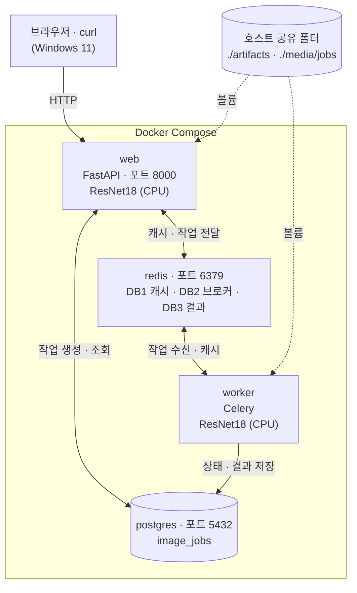
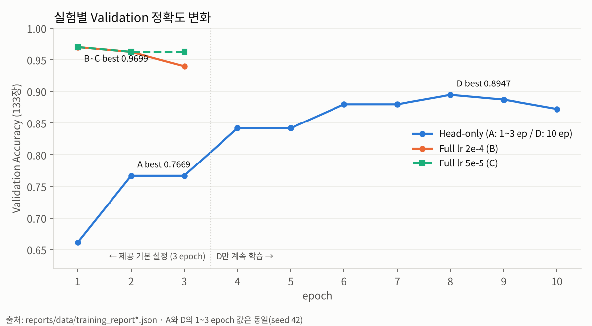
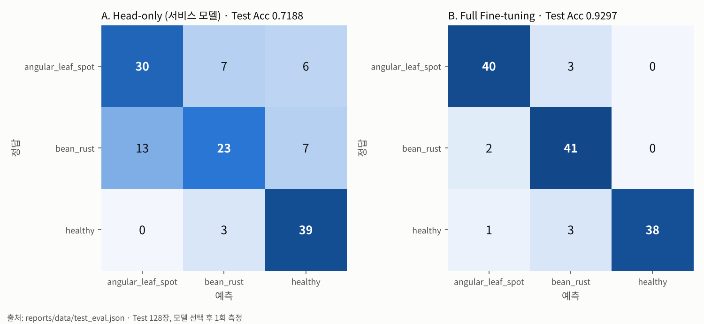
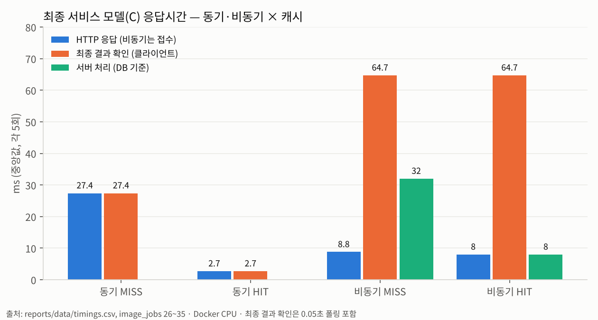

<div align="center">

# 🌱 콩잎 질병 분류 Vision AI

**콩잎 사진 한 장으로 각진잎반점병 · 녹병 · 정상을 판별하는 웹 서비스**<br/>
ResNet18 Fine-tuning · FastAPI 동기/비동기 · Redis · Celery · PostgreSQL


[📄 최종 기술보고서](reports/08_최종기술보고서.md) · [🏗 아키텍처](#-아키텍처) · [📊 모델 결과](#-모델-결과) · [⚡ 시스템 성능](#-시스템-성능) · [▶ 재실행 안내](#-재실행-안내)

</div>

---

## 📌 개요

교과 9 과제평가(2026.11.04) 프로젝트입니다. Hugging Face의 사전학습 모델 `microsoft/resnet-18`(ImageNet 1,000클래스)의 출력층을 3클래스로 바꾸고, 콩잎 데이터셋 [AI-Lab-Makerere/beans](https://huggingface.co/datasets/AI-Lab-Makerere/beans)로 Fine-tuning했습니다. 학습한 모델은 **동기 방식**(요청 → 바로 결과)과 **비동기 방식**(접수 202 → Celery Worker 처리 → 상태 조회) 두 경로로 서비스합니다.

| 클래스 | 의미 | Train | Val | Test |
|---|---|---:|---:|---:|
| `angular_leaf_spot` | 각진잎반점병 | 345 | 44 | 43 |
| `bean_rust` | 녹병 | 348 | 45 | 43 |
| `healthy` | 정상 | 341 | 44 | 42 |
| **합계** | | **1,034** | **133** | **128** |

이 프로젝트는 두 가지 질문에 **실측으로** 답합니다.

1. **모델**: Backbone을 고정한 기본 학습(Head-only)은 전체 가중치를 학습하는 Full Fine-tuning보다 얼마나 손해일까?
2. **시스템**: 비동기 방식의 추가 비용은 모델 추론과 처리 구조 중 어디서 생길까?

---

## ✨ 핵심 결과

| 영역 | 결과 | 근거 |
|---|---|---|
| **최종 서비스 모델** (C. Full lr 5e-5) | Val **97.0%** · Test **95.3%** (참고) · 질병 → 정상 오판 **0건** | [산출물 1 §8·9](reports/01_FineTuning_결과보고서.md) |
| 필수 기준선 (A. Head-only) | Val **76.7%** · Test **71.9%** · 질병 → 정상 오판 **13건** | [산출물 1](reports/01_FineTuning_결과보고서.md) |
| 비교 실험 (B. Full, lr 2e-4) | Val **97.0%** · Test **93.0%** (A 대비 +21.1%p) | [산출물 1](reports/01_FineTuning_결과보고서.md) |
| 추가 실험 (D. Head-only 10 epoch) | Val **89.5%** (A 대비 +12.8%p) | [산출물 1 §6](reports/01_FineTuning_결과보고서.md) |
| 캐시 효과 (동기 응답) | 27.4ms → **2.7ms** (90.1% 감소) | [산출물 6](reports/06_성능비교_보고서.md) |
| 비동기 접수 응답 | **8.8ms** (동기 대비 67.9% 빠름) | [산출물 6](reports/06_성능비교_보고서.md) |
| 비동기 서버 처리 (DB 기준) | MISS **32ms** · HIT **8ms** | [산출물 6](reports/06_성능비교_보고서.md) |
| 기능 테스트 | 실환경 **23건 PASS** · 모의 **4 passed** | [산출물 7](reports/07_기능테스트_오류분석.md) |

- **답 1**: 제공 기본 설정(3 epoch)에서 Backbone을 고정하면 Test 정확도가 21.1%p 낮고, 병든 잎을 정상으로 놓치는 오류가 생깁니다. 추가 실험으로 보면 이 차이의 상당 부분은 **학습 부족**(10 epoch로 Val +12.8%p)이고, 나머지는 **Backbone 고정 방식 자체의 한계**(Full 대비 Val −7.5%p)입니다. 필수 기준인 Head-only로 전체 기능을 검증한 뒤, 강사 확인을 거쳐 **최종 서비스 모델을 C(Full lr 5e-5)로 교체**했습니다. B와 C는 Validation이 같아(0.9699) **Validation 안정성**(이후 epoch 하락폭)으로 C를 골랐고, Test는 선택 근거로 쓰지 않았습니다.
- **답 2**: 비동기에서만 생기는 구조 비용(큐 전달 · DB 기록 · 파일 읽기)은 10ms 미만으로 작습니다. 모델 교체 전후 두 번 측정해 같은 결론을 얻었습니다. 사용자가 느끼는 지연은 대부분 **결과를 가져오는 폴링 간격**에서 생깁니다.

---

## 🏗 아키텍처

4개 서비스를 **Docker Compose**로 함께 실행하고, 추론은 컨테이너 안에서 **CPU**로 합니다 (학습만 로컬 RTX 3060 GPU 사용).



| 서비스 | 주요 파일 | 역할 |
|---|---|---|
| `web` | `main.py`, `ai/router_sync.py`, `ai/router_async.py` | 요청 검증, 동기 추론, 비동기 접수(202), 상태 조회 |
| `worker` | `ai/tasks.py`, `ai/celery_app.py` | 비동기 추론, `queued → running → done / failed` 갱신 |
| `redis` | `ai/cache_service.py` | DB1 결과 캐시(600초) · DB2 Celery 브로커 · DB3 결과 백엔드 |
| `postgres` | `ai/database.py`, `ai/models.py` | 비동기 작업 이력 (`image_jobs`) |
| 모델 | `ai/hf_model.py`, `ai/services.py` | web · worker **프로세스마다** 첫 요청 때 1회 로드 후 재사용 |

동기·비동기 흐름도와 장애 시 동작은 [산출물 2](reports/02_시스템_아키텍처.md), [산출물 5](reports/05_AI버튼_처리흐름.md)에 있습니다.

---

## 📊 모델 결과

제공 코드(`training/finetune.py`)는 그대로 두고 **실행 옵션만** 바꿔 4개 실험을 비교했습니다 (batch 8, seed 42 공통). A·B는 `--freeze-backbone` 유무만 다르고, C·D는 A·B에서 관찰한 과적합·학습 부족을 확인하려고 학습률과 epoch를 바꾼 추가 실험입니다.

| 실험 | 학습 대상 | epochs / lr | Best Val Acc | Test Acc | 녹병 Recall | 비고 |
|---|---|---|---:|---:|---:|---|
| A. Head-only | 분류층만 | 3 / 2e-4 | 0.7669 | 0.7188 | 0.5349 | 필수 기준선 |
| B. Full Fine-tuning | 전체 가중치 | 3 / 2e-4 | **0.9699** | 0.9297 | 0.9535 | 비교 실험 (선택) |
| **C. Full + 낮은 lr** | 전체 가중치 | 3 / 5e-5 | **0.9699** | 0.9531 * | 0.9070 | **최종 서비스 모델** |
| D. Head-only 10 epoch | 분류층만 | 10 / 2e-4 | 0.8947 | 0.8828 * | 0.7674 | 추가 실험 |

\* C·D는 A·B의 Test를 확인한 뒤 측정한 **참고 지표**입니다. 추가 실험과 최종 모델 선택은 Validation으로만 판단했고, Test로 모델을 고르거나 다시 학습하지 않았습니다.





- Head-only는 **녹병(bean_rust)을 각진잎반점병으로 많이 혼동**했고(13장), 병든 잎 86장 중 13장을 정상으로 판정했습니다.
- Full은 그 오류가 0건이지만, epoch 1 이후 Val 정확도가 떨어져 **과적합 경향**이 있습니다. 학습률을 낮추면(C) 하락이 줄지만 최고점(0.9699)은 같았습니다.
- Head-only도 10 epoch(D)로 늘리면 질병 → 정상 오판이 13건 → 1건으로 줄지만, 녹병과 각진잎반점병 혼동(9건)은 남았습니다.

자세한 데이터 점검과 오류 분석: [산출물 1](reports/01_FineTuning_결과보고서.md)

---

## ⚡ 시스템 성능

최종 서비스 모델(C) 기준, Docker CPU 추론, 조건별 5회 중앙값입니다. 측정 직전 캐시를 비우고 MISS → HIT 순으로 측정했습니다. 괄호는 교체 전 Head-only(A)로 같은 이미지를 측정한 값입니다.

| 경로 | 캐시 | HTTP 응답 | 최종 결과 확인 | 모델 추론 | 서버 처리 (DB 기준) |
|---|---|---:|---:|---:|---:|
| 동기 | MISS | 27.4ms (41.2) | 27.4ms (41.2) | 20.74ms (28.94) | — |
| 동기 | HIT | **2.7ms** (4.3) | 2.7ms (4.3) | 생략 | — |
| 비동기 | MISS | **8.8ms** 접수 (13.4) | 64.7ms (71.6) | 19.32ms (24.24) | 32ms (39) |
| 비동기 | HIT | 8.0ms 접수 (9.6) | 64.7ms (66.3) | 생략 | 8ms (9) |



- 비동기 접수가 빠른 건 **추론이 빨라져서가 아니라** 처리를 worker로 넘기고 `job_id`만 먼저 돌려주기 때문입니다.
- 비동기 "최종 결과 확인"은 0.05초 간격 폴링을 포함한 값이라, 실제 서버 처리 시간은 DB 기준 값(32ms / 8ms)이 더 정확합니다.
- 두 모델은 같은 ResNet18 구조라 추론 비용이 같습니다. 1차·2차의 절대값 차이는 측정 회차 간 편차이며, 결론(캐시 약 90%, 접수 약 68% 단축)은 두 번 모두 같았습니다.
- 모델 첫 로딩(약 2~3.7초)은 비교에서 제외했습니다.

측정 조건·원본값·해석: [산출물 6](reports/06_성능비교_보고서.md)

---

## ▶ 재실행 안내

> `dataset/`과 `artifacts/`(학습 모델)는 용량 때문에 저장소에 없습니다. 아래 순서대로 준비하세요. 각 단계 제목을 누르면 명령이 펼쳐집니다.

**실행 환경**

| 항목 | 요구 사항 | 검증한 환경 |
|---|---|---|
| OS | Windows + WSL2 (또는 Linux) | Windows 11 Pro 25H2 + WSL2 Ubuntu 26.04.1 LTS |
| Docker | Docker Desktop / Docker Compose | Docker 29.9.2 · Compose v5.6.1 |
| 학습 (선택) | Python 3.11 이상 가상환경, NVIDIA GPU가 있으면 자동 사용 | Python 3.14.4 · torch 2.15.0+cu132 · RTX 3060 |
| 서비스 컨테이너 | Dockerfile이 자동 설치 | Python 3.11.18 · torch 2.5.1+cpu · transformers 4.57.6 |

<details>
<summary><b>1. 데이터 준비</b> — Hugging Face에서 받아 <code>dataset/</code>에 배치</summary>

```bash
# 원본 보관 폴더에 받기
mkdir -p ~/beans_source && cd ~/beans_source
for f in train validation test; do
  wget https://huggingface.co/datasets/AI-Lab-Makerere/beans/resolve/main/data/$f.zip
  unzip -q $f.zip
done

# 프로젝트로 복사 (validation → val 로 이름 변경 필수)
cd ~/fastapi_resnet18
mkdir -p dataset/{train,val,test}
cp -r ~/beans_source/train/*      dataset/train/
cp -r ~/beans_source/validation/* dataset/val/
cp -r ~/beans_source/test/*       dataset/test/
```

결과 구조:

```text
dataset/
├── train/{angular_leaf_spot, bean_rust, healthy}/   # 1,035 파일 (학습 사용 1,034장)
├── val/  {angular_leaf_spot, bean_rust, healthy}/   # 133장
└── test/ {angular_leaf_spot, bean_rust, healthy}/   # 128장
```

`dataset/train/healthy/`의 비표준 확장자 파일 1개(`.120tore`)는 학습 코드가 자동으로 건너뜁니다.

</details>

<details>
<summary><b>2. 모델 학습</b> — 필수 기준선 A와 최종 서비스 모델 C 생성</summary>

**방법 A — 로컬 가상환경 (검증한 방법, GPU가 있으면 자동 사용)**

```bash
python3 -m venv .venv && source .venv/bin/activate
python -m pip install -r requirements.txt
python -m training.finetune --data dataset --output artifacts/beans_resnet18 \
  --epochs 3 --batch-size 8 --freeze-backbone
```

**방법 B — Docker trainer**

```bash
cp .env.example .env
docker compose build
docker compose run --rm trainer
```

결과 파일: `config.json`, `model.safetensors`, `preprocessor_config.json`, `training_report.json`

방법 B(trainer)는 필수 기준선 A만 만듭니다.

**최종 서비스 모델(C) 학습** (방법 A 환경에서)

```bash
python -m training.finetune --data dataset --output artifacts/beans_resnet18_full_lr5e-5 \
  --epochs 3 --batch-size 8 --lr 0.00005
```

(선택) 비교 실험 B: `--freeze-backbone`을 빼고 `--output artifacts/beans_resnet18_full` · D: `--freeze-backbone --epochs 10 --output artifacts/beans_resnet18_head10`

</details>

<details>
<summary><b>3. 서비스 실행</b> — 4개 컨테이너 한 번에 기동</summary>

```bash
cd ~/fastapi_resnet18
cp .env.example .env          # 기본값 MODEL_PATH=artifacts/beans_resnet18 (필수 기준선 A)
sed -i 's|^MODEL_PATH=.*|MODEL_PATH=artifacts/beans_resnet18_full_lr5e-5|' .env   # 최종 서비스 모델 C
mkdir -p media/jobs
docker compose up -d --build  # redis, postgres, web, worker 동시 실행

docker compose ps                        # 4개 Up, web·redis·postgres는 (healthy)
docker compose logs --tail=40 web worker # worker에 "celery@... ready." 확인
curl http://127.0.0.1:8000/health        # {"status":"ok"}
```

서비스를 실행한 **같은 컴퓨터의 브라우저**에서 아래 주소로 접속합니다. (`127.0.0.1`은 자기 컴퓨터를 뜻하므로, GitHub에서 클릭해서는 열리지 않습니다.)

| 주소 | 화면 |
|---|---|
| `http://127.0.0.1:8000/vision/sync/` | 동기 분류 화면 |
| `http://127.0.0.1:8000/vision/async/` | 비동기 분류 화면 |
| `http://127.0.0.1:8000/docs` | Swagger API 문서 |

로컬에서 따로 `uvicorn`을 실행하지 마세요. web 컨테이너가 8000 포트를 사용합니다.

</details>

<details>
<summary><b>4. API로 확인</b> — 동기 · 비동기 · DB 기록</summary>

```bash
IMG="$(find dataset/test/healthy -maxdepth 1 -iname '*.jpg' -print -quit)"

# 동기: 결과가 바로 응답에 포함 (200)
curl -X POST -F "image=@${IMG}" http://127.0.0.1:8000/api/sync/classify/

# 비동기: 작업 번호만 먼저 반환 (202)
curl -i -X POST -F "image=@${IMG}" http://127.0.0.1:8000/api/async/classify/

# 상태 조회: status가 done이면 완료 (받은 job_id로 교체)
curl http://127.0.0.1:8000/api/async/jobs/1/

# DB 기록 확인 (비동기 작업만 저장)
docker compose exec postgres psql -U vision_user -d vision_db -c \
  'SELECT id, status, top1_label, top1_score, cache_hit, inference_ms FROM image_jobs ORDER BY id DESC LIMIT 10;'
```

요청·응답 형식: [산출물 3](reports/03_API_명세서.md)

</details>

<details>
<summary><b>5. 테스트와 측정 도구</b></summary>

```bash
# 모의 통합 테스트 (모델·Redis·Celery를 가짜로 바꿔 API 동작 검증)
docker compose exec web python -m pytest -q tests/test_api.py   # 4 passed
```

`pytest`만 입력하면 `ModuleNotFoundError: No module named 'ai'`가 납니다. 반드시 `python -m pytest`로 실행하세요.

평가용 보조 스크립트 (제공 코드 아님):

```bash
python reports/measure_timings.py      # 동기/비동기 × 캐시 MISS/HIT 응답시간 → reports/data/timings.csv
python reports/evaluate_test.py artifacts/beans_resnet18 artifacts/beans_resnet18_full   # Test 1회 평가
```

</details>

<details>
<summary><b>6. 종료 · 재시작</b></summary>

```bash
docker compose stop                                # 중지 (데이터 보존)
docker compose up -d                               # 재시작
docker compose up -d --build                       # 코드·Dockerfile 변경 시
docker compose up -d --force-recreate web worker   # 모델이나 .env 변경 시
```

⚠️ `docker compose down -v`는 PostgreSQL·Redis 데이터를 삭제합니다.

</details>

<details>
<summary><b>🛠 문제 해결</b></summary>

| 현상 | 확인할 것 |
|---|---|
| `web`이 뜨지 않음 | `docker compose logs web`, postgres가 healthy인지 |
| 비동기 작업이 계속 `queued` | `docker compose logs worker`, worker 컨테이너가 Up인지 |
| 비동기 접수가 503 | Redis 컨테이너 상태 (`docker compose ps redis`) |
| 라벨이 ImageNet 사물 이름으로 나옴 | `.env`의 `MODEL_PATH`가 학습한 모델 폴더(`artifacts/beans_resnet18_full_lr5e-5` 등)인지, 학습했는지 |
| 모델을 바꿨는데 반영이 안 됨 | `docker compose up -d --force-recreate web worker`로 두 컨테이너 모두 재시작 |
| `address already in use` | 8000·6379·5432 포트를 쓰는 다른 프로그램(로컬 uvicorn 등) 종료 |
| 첫 요청만 2~3초 걸림 | 정상 — 프로세스마다 첫 요청에서 모델을 로드 |

</details>

---

## 📁 산출물

| # | 문서 | 내용 |
|---|---|---|
| 1 | [Fine-tuning 결과보고서](reports/01_FineTuning_결과보고서.md) | 데이터 점검, 학습 설정·결과, Test 평가, 오류 분석 |
| 2 | [시스템 아키텍처](reports/02_시스템_아키텍처.md) | 구성도, 컴포넌트 역할, Compose 구성, 실행환경 |
| 3 | [API 명세서](reports/03_API_명세서.md) | API 요청·응답·오류, 실행 근거 |
| 4 | [DB 구조·작업이력](reports/04_DB_구조_작업이력.md) | `image_jobs` 정의, 상태 전이, 작업이력 |
| 5 | [AI 버튼 처리흐름](reports/05_AI버튼_처리흐름.md) | 동기·비동기 시퀀스, 코드 대응표 |
| 6 | [성능비교 보고서](reports/06_성능비교_보고서.md) | 측정 조건·원본값·해석 |
| 7 | [기능테스트·오류분석](reports/07_기능테스트_오류분석.md) | 실환경·모의 테스트, 오류 이력 |
| 8 | [최종 기술보고서](reports/08_최종기술보고서.md) | 종합 보고, 개선 제안 |

<details>
<summary>폴더 구조</summary>

```text
fastapi_resnet18/
├── ai/                    # FastAPI 라우터, 모델 로드, 캐시, DB, Celery 작업
├── training/finetune.py   # Fine-tuning 코드
├── templates/, static/    # 웹 화면
├── tests/test_api.py      # 모의 통합 테스트
├── main.py                # FastAPI 앱
├── Dockerfile, compose.yaml, .dockerignore
├── requirements.txt, .env.example
├── reports/               # 산출물 1~8, evidence(증빙), data(측정 원본), figures(그래프), 측정 도구
├── dataset/               # (저장소 제외) 콩잎 이미지
├── artifacts/             # (저장소 제외) 학습 모델
└── media/jobs/            # (저장소 제외) 비동기 업로드 이미지
```

</details>

---

## 🔒 보안 · 라이선스

- `.env`, `dataset/`, `artifacts/`, `media/jobs/`는 `.gitignore`로 저장소에서 제외했습니다.
- `compose.yaml`의 DB 계정(`vision_user` / `vision_pass`)은 로컬 실습용 기본값이며, 모든 포트는 `127.0.0.1`에만 열려 있습니다.
- 모델: `microsoft/resnet-18` (Apache-2.0) · 데이터: `AI-Lab-Makerere/beans` (MIT 표기) — 사용·공유 전 각 저장소의 이용 조건을 확인하세요.
