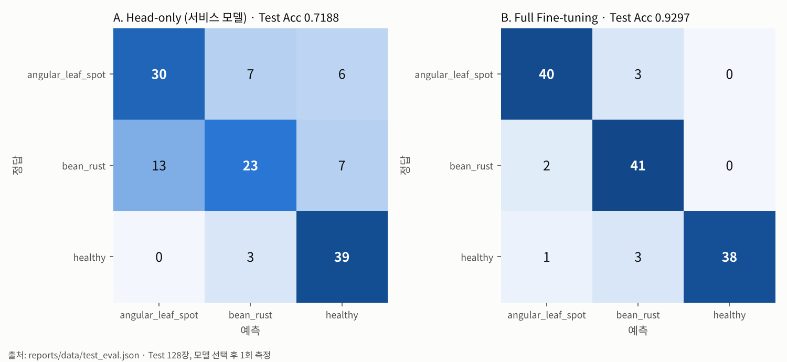
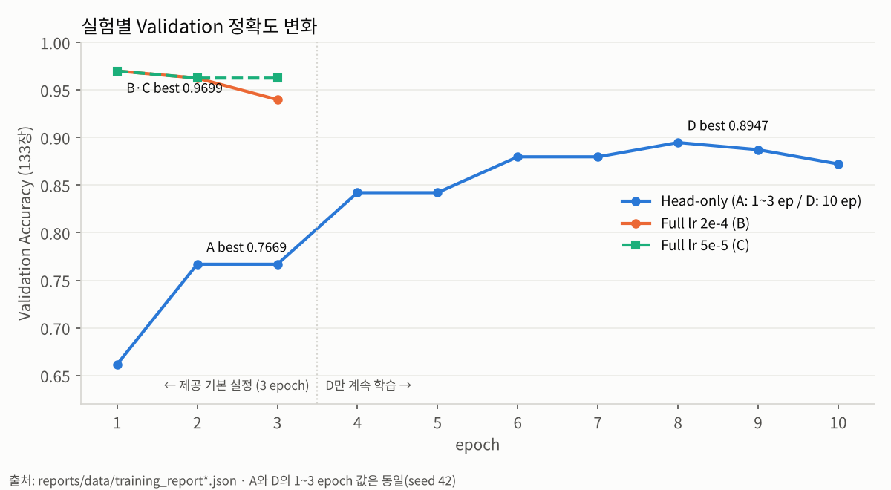
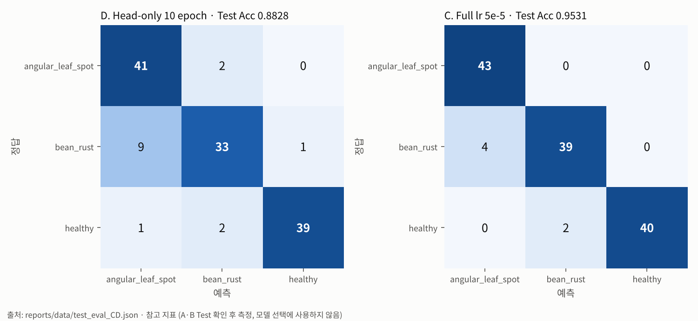

# 산출물 1. ResNet18 콩잎 3클래스 Fine-tuning 결과보고서

| 항목 | 내용 |
|---|---|
| 평가 대상 | 콩잎 이미지 3클래스 분류 (`angular_leaf_spot` / `bean_rust` / `healthy`) |
| 기준 모델 | `microsoft/resnet-18` (ImageNet 1,000클래스 사전학습, Apache-2.0) |
| 필수 학습 방식 | **Head-only Fine-tuning** (`--freeze-backbone`, Backbone 고정) |
| 선택 비교 실험 | B. Full Fine-tuning (`--freeze-backbone` 미사용, 전체 가중치 학습) |
| 추가 실험 | C. Full + 낮은 학습률(5e-5), D. Head-only 10 epoch — **Validation으로 비교** (6장) |
| 학습·검증 데이터 | `dataset/train`, `dataset/val` |
| 별도 보관 데이터 | `dataset/test` (학습·모델 선택에 사용하지 않음) |
| 서비스 연결 모델 | `artifacts/beans_resnet18/` (Head-only) |
| 실험 상태 | **실행 완료** |

---

## 1. 데이터 준비

### 1-1. 출처와 폴더 매핑

- 출처: Hugging Face [`AI-Lab-Makerere/beans`](https://huggingface.co/datasets/AI-Lab-Makerere/beans) (`train.zip`, `validation.zip`, `test.zip`, 데이터셋 라이선스 표기 MIT)
- 원본은 `~/beans_source/`에 압축 해제 후 **보존**하고, 제공 코드가 읽는 경로로 **복사**했다.

| 원본 (보존) | 코드 실행용 (복사) | 용도 |
|---|---|---|
| `beans_source/train/` | `dataset/train/` | 가중치 학습 |
| `beans_source/validation/` | **`dataset/val/`** | 학습 중 검증, Best 모델 선택 |
| `beans_source/test/` | `dataset/test/` | 학습 종료 후 별도 1회 평가 |

`validation` → `val` 이름 변경은 제공 코드(`finetune.py`)가 `dataset/val/`을 읽기 때문이며, 코드 경로는 수정하지 않았다.

### 1-2. 클래스별 이미지 개수

| 클래스 | Train (폴더 파일 수) | Train (학습 사용) | Validation | Test |
|---|---:|---:|---:|---:|
| angular_leaf_spot | 345 | 345 | 44 | 43 |
| bean_rust | 348 | 348 | 45 | 43 |
| healthy | 342 | **341** | 44 | 42 |
| **합계** | **1,035** | **1,034** | **133** | **128** |

- `dataset/train/healthy/healthy_train.120tore` 1개 파일은 확장자가 비표준이라, 제공 코드의 확장자 필터(`.jpg/.jpeg/.png/.webp`)에서 제외되었다. 원본 데이터를 임의로 수정하지 않고 그대로 두었다.
- 따라서 `training_report.json`의 `train_count`는 **1,034**이다.

### 1-3. 중복·누출 점검

| 점검 | 방법 | 결과 |
|---|---|---|
| Split 간 동일 파일 | `dataset/` 전체 파일의 md5 해시 비교 (`md5sum` → `uniq -d`) | **중복 0건** |

> 한계: md5는 **완전히 같은 파일**만 찾는다. 같은 잎을 다른 각도로 찍은 유사 이미지까지는 확인하지 않았다.

---

## 2. Fine-tuning 방식

`microsoft/resnet-18`의 1,000클래스 출력층을 3클래스 출력층으로 교체한 뒤(`ignore_mismatched_sizes=True`), 새 분류층을 학습했다.

| 구분 | 실행 옵션 | 학습 대상 |
|---|---|---|
| A. Head-only (필수) | `--freeze-backbone` | 이름이 `classifier.`로 시작하는 분류층만 학습 (Linear 512→3, 구조상 1,539개 파라미터) |
| B. Full Fine-tuning (선택) | 옵션 없음 | Backbone을 포함한 전체 가중치 학습 |

- 두 실험은 **`--freeze-backbone` 유무만 다르고** 나머지 설정은 모두 같다.
- 제공 코드 `training/finetune.py`는 수정하지 않았고, 실행 옵션만 사용했다.

---

## 3. 실행 설정

| 파라미터 | A. Head-only | B. Full |
|---|---|---|
| base_model | microsoft/resnet-18 | microsoft/resnet-18 |
| epochs | 3 | 3 |
| batch_size | 8 | 8 |
| learning_rate | 0.0002 (기본값) | 0.0002 (기본값) |
| freeze_backbone | **True** | **False** |
| seed | 42 (제공 코드) | 42 (제공 코드) |
| output | `artifacts/beans_resnet18` | `artifacts/beans_resnet18_full` |

epochs 3, batch 8, lr 2e-4는 모두 제공 문서 명령과 `finetune.py` 기본값이다.

**실행 명령**

```bash
# A. Head-only (필수)
python -m training.finetune --data dataset --output artifacts/beans_resnet18 \
  --epochs 3 --batch-size 8 --freeze-backbone 2>&1 | tee reports/evidence/train_log.txt

# B. Full Fine-tuning (선택 비교)
python -m training.finetune --data dataset --output artifacts/beans_resnet18_full \
  --epochs 3 --batch-size 8 2>&1 | tee reports/evidence/train_log_full.txt
```

**학습 환경**

| 항목 | 값 |
|---|---|
| OS | Windows 11 Pro 25H2 + WSL2 Ubuntu 26.04.1 LTS |
| CPU / RAM | Intel Core i7-12700 / WSL 할당 15GiB |
| GPU | **NVIDIA GeForce RTX 3060** (`torch.cuda.is_available()=True`, 코드가 자동 선택) |
| Python / PyTorch | 3.14.4 / 2.15.0+cu132 |

> 학습은 로컬 GPU, 서비스(FastAPI·Celery) 추론은 Docker 컨테이너의 CPU(torch 2.5.1+cpu)에서 수행했다. `safetensors` 형식으로 저장해 버전이 달라도 모델을 정상 로드했다.

---

## 4. 학습 결과

### 4-1. A. Head-only (필수)

| Epoch | Train Loss | Validation Accuracy |
|---:|---:|---:|
| 1 | 0.9924 | 0.6617 |
| 2 | 0.8108 | **0.7669** |
| 3 | 0.7078 | 0.7669 |

- **Best Validation Accuracy: 0.7669** (133장 중 102장)
- 저장된 모델: **epoch 2 시점** (코드가 `acc > best_acc`일 때만 저장하므로, 같은 정확도인 epoch 3은 덮어쓰지 않음)
- Loss가 3 epoch까지 계속 감소해 **학습이 충분히 수렴하지 않은 상태**로 판단된다.

### 4-2. B. Full Fine-tuning (선택)

| Epoch | Train Loss | Validation Accuracy |
|---:|---:|---:|
| 1 | 0.4263 | **0.9699** |
| 2 | 0.2033 | 0.9624 |
| 3 | 0.1104 | 0.9398 |

- **Best Validation Accuracy: 0.9699** (133장 중 129장)
- 저장된 모델: **epoch 1 시점**
- Loss는 계속 줄었지만 Validation Accuracy는 epoch 1 이후 하락해 **과적합 경향**이 관찰되었다.

### 4-3. A·B 비교 (같은 Validation 133장)

| 실험 | 학습 대상 | Best Val Acc | 최고 epoch |
|---|---|---:|---:|
| A. Head-only | 분류층만 | 0.7669 | 2 |
| B. Full | 전체 가중치 | **0.9699** | 1 |
| 차이 | | **+0.2030 (20.3%p)** | |

Backbone을 고정하면 ImageNet 사물 분류용 특징을 그대로 쓰게 된다. Full Fine-tuning은 Backbone까지 콩잎 병반의 색과 무늬에 맞게 조정되어 정확도가 크게 높아진 것으로 해석된다.

---

## 5. Test 세트 별도 평가 (1회)

> **절차**: 제공 `finetune.py`는 Test 지표를 계산하지 않으므로, 저장된 모델을 읽기만 하는 측정 도구 `reports/evaluate_test.py`를 별도로 작성해 실행했다. **모델 선택은 Validation 기준으로 끝난 뒤**, Test는 결과 확인용으로 **1회만** 측정했다. 이 결과를 보고 모델·설정을 다시 바꾸지 않았다.

### 5-1. 정확도

| 모델 | Val Acc | **Test Acc** | 차이 |
|---|---:|---:|---:|
| A. Head-only (서비스 모델) | 0.7669 | **0.7188** (92/128) | -4.8%p |
| B. Full Fine-tuning | 0.9699 | **0.9297** (119/128) | -4.0%p |

두 모델 모두 Test가 Validation보다 4~5%p 낮다. Validation으로 Best epoch를 골랐기 때문에 Validation 수치가 다소 낙관적으로 나온 것으로 본다.

### 5-2. 클래스별 지표

| 클래스 | A Precision | A Recall | A F1 | B Precision | B Recall | B F1 |
|---|---:|---:|---:|---:|---:|---:|
| angular_leaf_spot | 0.6977 | 0.6977 | 0.6977 | 0.9302 | 0.9302 | 0.9302 |
| bean_rust | 0.6970 | **0.5349** | 0.6053 | 0.8723 | 0.9535 | 0.9111 |
| healthy | 0.7500 | 0.9286 | 0.8298 | 1.0000 | 0.9048 | 0.9500 |

### 5-3. 혼동행렬 (행 = 정답, 열 = 예측)

**A. Head-only**

| 정답 \ 예측 | angular_leaf_spot | bean_rust | healthy |
|---|---:|---:|---:|
| angular_leaf_spot | **30** | 7 | 6 |
| bean_rust | 13 | **23** | 7 |
| healthy | 0 | 3 | **39** |

**B. Full Fine-tuning**

| 정답 \ 예측 | angular_leaf_spot | bean_rust | healthy |
|---|---:|---:|---:|
| angular_leaf_spot | **40** | 3 | 0 |
| bean_rust | 2 | **41** | 0 |
| healthy | 1 | 3 | **38** |



### 5-4. 오류 분석

1. **Head-only는 bean_rust를 가장 못 맞혔다 (Recall 0.5349).** 43장 중 13장을 angular_leaf_spot으로 예측했다. 두 질병 모두 잎에 반점이 생기는 증상이라, 고정된 ImageNet 특징만으로는 구분이 어려웠던 것으로 보인다.
2. **Head-only의 가장 위험한 오류는 "질병 잎 → healthy"이다.** 질병 잎 86장 중 **13장(15.1%)** 을 정상으로 판정했다. 실제 사용 환경에서는 병을 놓치는 오류가 정상 잎을 질병으로 보는 오류보다 피해가 크다.
3. **Full Fine-tuning은 "질병 잎 → healthy" 오류가 0건**이다. 남은 오류는 두 질병 간 혼동 5건, 정상 잎을 질병으로 본 4건이다.

---

## 6. 추가 실험 — 학습 옵션 변경 (Validation 비교)

4장의 관찰(Head-only는 Loss가 계속 감소 = 덜 학습됨, Full은 epoch 1 이후 하락 = 과적합 경향)을 확인하려고, **제공 코드는 그대로 두고 실행 옵션만** 바꿔 2개 실험을 추가했다. 기존 A·B 결과를 덮어쓰지 않도록 출력 폴더를 따로 사용했다.

> **원칙**: 추가 실험의 비교와 판단은 **Validation으로만** 한다. 이 실험들을 하기 전에 A·B의 Test 결과를 이미 확인했으므로, C·D의 Test 값은 **참고 지표**로만 기록하고 모델 선택·재학습에는 사용하지 않는다. 서비스 모델(A)은 바꾸지 않는다.

```bash
# C. Full + 낮은 학습률 (평가가이드 6-1 예시 설정)
python -m training.finetune --data dataset --output artifacts/beans_resnet18_full_lr5e-5 \
  --epochs 3 --batch-size 8 --lr 0.00005 2>&1 | tee reports/evidence/train_log_full_lr5e-5.txt

# D. Head-only 10 epoch
python -m training.finetune --data dataset --output artifacts/beans_resnet18_head10 \
  --epochs 10 --batch-size 8 --freeze-backbone 2>&1 | tee reports/evidence/train_log_head10.txt
```

### 6-1. D. Head-only 10 epoch

| Epoch | 1 | 2 | 3 | 4 | 5 | 6 | 7 | **8** | 9 | 10 |
|---|---:|---:|---:|---:|---:|---:|---:|---:|---:|---:|
| Train Loss | 0.9924 | 0.8108 | 0.7078 | 0.6454 | 0.6012 | 0.5554 | 0.5520 | 0.5107 | 0.5184 | 0.4942 |
| Val Acc | 0.6617 | 0.7669 | 0.7669 | 0.8421 | 0.8421 | 0.8797 | 0.8797 | **0.8947** | 0.8872 | 0.8722 |

- **Best Val 0.8947 (epoch 8, 119/133)** — 3 epoch(A, 0.7669)보다 **+12.8%p**. A가 덜 학습된 상태였음을 실측으로 확인했다.
- epoch 8 이후 Val이 조금씩 하락해, 이 설정에서는 8 epoch 근처가 한계로 보인다.
- **재현성 확인**: epoch 1~3의 Loss·Val Acc가 실험 A와 소수점까지 같다. 제공 코드의 seed 42 고정으로 같은 설정이면 같은 결과가 나온다.

### 6-2. C. Full + 낮은 학습률 (lr 5e-5)

| Epoch | B. lr 2e-4 Loss | **C. lr 5e-5 Loss** | B. lr 2e-4 Val | **C. lr 5e-5 Val** |
|---:|---:|---:|---:|---:|
| 1 | 0.4263 | 0.4404 | 0.9699 | **0.9699** |
| 2 | 0.2033 | 0.1552 | 0.9624 | 0.9624 |
| 3 | 0.1104 | 0.0850 | 0.9398 | **0.9624** |

- **Best Val은 B와 같은 0.9699 (epoch 1, 129/133)** — 최고 성능은 높아지지 않았다.
- epoch 3의 하락이 0.9398 → 0.9624로 줄었다. 학습률을 낮추자 epoch가 지나도 성능이 덜 떨어져, **과적합 완화 효과는 있으나 최고점은 그대로**였다.

### 6-3. 전체 비교와 Validation 기준 결론



| 실험 | 학습 대상 | epochs / lr | Best Val Acc | 최고 epoch |
|---|---|---|---:|---:|
| A. Head-only | 분류층만 | 3 / 2e-4 | 0.7669 | 2 |
| D. Head-only | 분류층만 | 10 / 2e-4 | 0.8947 | 8 |
| B. Full | 전체 | 3 / 2e-4 | **0.9699** | 1 |
| C. Full | 전체 | 3 / 5e-5 | **0.9699** | 1 |

**Test를 측정하기 전에 확정한 결론**

1. Validation으로는 **B와 C를 구분할 수 없다** (둘 다 133장 중 129장). C는 epoch 후반이 더 안정적이라는 차이만 있다.
2. Head-only는 학습을 늘리면 크게 좋아지지만(+12.8%p), Backbone까지 학습하는 Full에는 미치지 못한다(−7.5%p).
3. 서비스 모델은 평가 기준대로 **A(Head-only)를 유지**한다.

### 6-4. Test 참고 지표 (모델 선택에 사용하지 않음)

> C·D의 Test는 위 결론을 정한 **뒤에** 같은 도구(`reports/evaluate_test.py`)로 측정했다. A·B Test 결과를 이미 본 상태에서 측정한 값이므로 **독립적인 최종 평가가 아니라 참고용**이다. 원본: [data/test_eval_CD.json](data/test_eval_CD.json)

| 실험 | Best Val | Test Acc (맞힌 수) | Val−Test | 녹병 Recall | 질병 → healthy 오판 |
|---|---:|---:|---:|---:|---:|
| A. Head-only 3 ep | 0.7669 | 0.7188 (92) | −4.8%p | 0.5349 | 13 |
| D. Head-only 10 ep | 0.8947 | 0.8828 (113) | −1.2%p | 0.7674 | 1 |
| B. Full lr 2e-4 | 0.9699 | 0.9297 (119) | −4.0%p | 0.9535 | 0 |
| C. Full lr 5e-5 | 0.9699 | 0.9531 (122) | −1.7%p | 0.9070 | 0 |



- **D는 Head-only의 약점을 크게 줄였다.** Test가 0.7188 → 0.8828, 질병 → healthy 오판이 13 → 1건이다. A의 약점 상당 부분은 방식 자체보다 **학습 부족** 때문이었다.
- D에도 **녹병 → 각진잎반점병 혼동(9건)** 이 남아 있다. 두 질병 구분은 분류층만 학습해서는 한계가 있다.
- C는 Test에서 B보다 3장 더 맞혔지만(122 vs 119), **Validation에서는 동률**이었고 128장 중 3장 차이는 작다. 이 결과로 C가 B보다 낫다고 결론 내리지 않는다.

---

## 7. 생성 파일 확인

`ls -lh artifacts/beans_resnet18/`

| 파일 | 크기 | 확인 |
|---|---:|:---:|
| `config.json` | 808B | ✅ |
| `model.safetensors` | 43MB | ✅ |
| `preprocessor_config.json` | 352B | ✅ |
| `training_report.json` | 468B | ✅ |

`model.safetensors` 43MB는 ResNet18 규모(약 1,100만 파라미터)와 일치한다. `artifacts/`는 `.gitignore`로 저장소에서 제외되므로, 학습 기록은 `reports/data/`에 복사해 두었다.

---

## 8. 서비스 연결 확인

- `.env`: `MODEL_PATH=artifacts/beans_resnet18`
- 모든 응답의 `model_id`가 `artifacts/beans_resnet18`이고, 라벨이 ImageNet 클래스가 아닌 **콩잎 3클래스**로 출력됨을 확인했다.

| 경로 | 입력 이미지 (정답) | top1.label | top1.score | 정답 일치 |
|---|---|---|---:|:---:|
| 01 동기 (로컬) | angular_leaf_spot_test.1.jpg | angular_leaf_spot | 0.5182 | ✅ |
| 01 동기 (로컬) | bean_rust_test.0.jpg | bean_rust | 0.6051 | ✅ |
| 01 동기 (로컬) | healthy_test.0.jpg | healthy | 0.6369 | ✅ |
| 02 동기 (Docker) | healthy_test.39.jpg | healthy | 0.8066 | ✅ |
| 02 비동기 job 1 | bean_rust_test.35.jpg | bean_rust | 0.4388 | ✅ |
| 02 비동기 job 4 | angular_leaf_spot_test.10.jpg | angular_leaf_spot | 0.5146 | ✅ |

> 위 표는 **동작 확인용 샘플**이며 정확도 지표가 아니다. 정량 성능은 4장(Validation), 5장(Test), 6장(추가 실험)을 따른다. 점수가 0.4~0.6대로 낮고, job 1은 2위 healthy(0.4356)와 차이가 0.003에 불과해 Head-only 모델의 확신도가 낮음을 보여준다.

---

## 9. 결과 판정

| 구분 | 판정 |
|---|---|
| 필수: Head-only Fine-tuning 학습·모델 저장 | **완료** (Best Val Acc 0.7669) |
| 필수: 학습 모델의 동기·비동기 서비스 연결 | **완료** |
| 선택: Full Fine-tuning 비교 | **완료** (Best Val Acc 0.9699, +20.3%p) |
| 추가: Test 세트 별도 평가 | **완료** (A 0.7188 / B 0.9297, 모델 선택 후 1회) |
| 추가: 학습 옵션 실험 C·D | **완료** (Val 비교: C 0.9699 / D 0.8947, Test는 참고 지표) |

**서비스 모델 결정**: 평가 기준(필수 = Head-only, 서비스 경로 = `artifacts/beans_resnet18`)에 맞춰 **Head-only 모델을 서비스에 연결**했다. Full Fine-tuning 모델은 비교 실험 결과로 보관하며, 서비스 교체는 [산출물 8](08_최종기술보고서.md)의 개선 제안으로 다룬다.

**한계**

- Head-only(서비스 모델)는 3 epoch에서 덜 학습된 상태다. 10 epoch로 늘리면 Val 0.8947까지 오르는 것을 확인했지만(6장), 평가 기준에 따라 서비스 모델은 바꾸지 않았다.
- Full은 epoch 1 이후 Validation 성능이 하락해 과적합 경향이 있다. 학습률을 낮추면(C) 하락은 줄지만 최고점은 같았다.
- Validation을 Best 모델 선택에 사용해 Validation 수치가 Test보다 1~5%p 높게 나왔다.
- Validation 133장은 1장이 약 0.75%p에 해당해, B·C처럼 작은 차이는 구분하기 어렵다.
- C·D의 Test 값은 A·B Test를 확인한 뒤 측정해 독립적인 최종 평가가 아니다.
- md5로는 유사 이미지(같은 잎의 다른 사진) 중복을 확인할 수 없다.
- 학습 환경(로컬 GPU, torch 2.15)과 서비스 환경(Docker CPU, torch 2.5.1)이 다르다.

---

## 10. 증빙

| 내용 | 파일 |
|---|---|
| 클래스별 개수 | [evidence/data_count.png](evidence/data_count.png) |
| md5 중복 점검 | [evidence/md5_check.png](evidence/md5_check.png) |
| 비표준 확장자 파일 | [evidence/nonimage_file.png](evidence/nonimage_file.png) |
| GPU 확인 | [evidence/gpu_check.png](evidence/gpu_check.png) |
| 학습 로그 (A / B) | [evidence/train_log.txt](evidence/train_log.txt) / [evidence/train_log_full.txt](evidence/train_log_full.txt) |
| 학습 로그 (C / D) | [evidence/train_log_full_lr5e-5.txt](evidence/train_log_full_lr5e-5.txt) / [evidence/train_log_head10.txt](evidence/train_log_head10.txt) |
| 학습 결과 화면 (A / B) | [evidence/training_report_head.png](evidence/training_report_head.png) / [evidence/training_report_full.png](evidence/training_report_full.png) |
| 모델 폴더 | [evidence/model_folder.png](evidence/model_folder.png) |
| 01 동기 분류 화면 | [angular](evidence/ui_sync_01_angular.png) · [bean_rust](evidence/ui_sync_01_bean_rust.png) · [healthy](evidence/ui_sync_01_healthy.png) |
| 학습 기록 원본 | [A](data/training_report.json) · [B](data/training_report_full.json) · [C](data/training_report_full_lr5e-5.json) · [D](data/training_report_head10.json) |
| Test 평가 원본 | [A·B](data/test_eval.json) · [C·D 참고](data/test_eval_CD.json) (도구: `reports/evaluate_test.py`) |
| 그림 | [A·B 혼동행렬](figures/confusion_matrix_test.png) · [C·D 혼동행렬](figures/confusion_matrix_test_extra.png) · [Val 곡선](figures/val_curves.png) |
