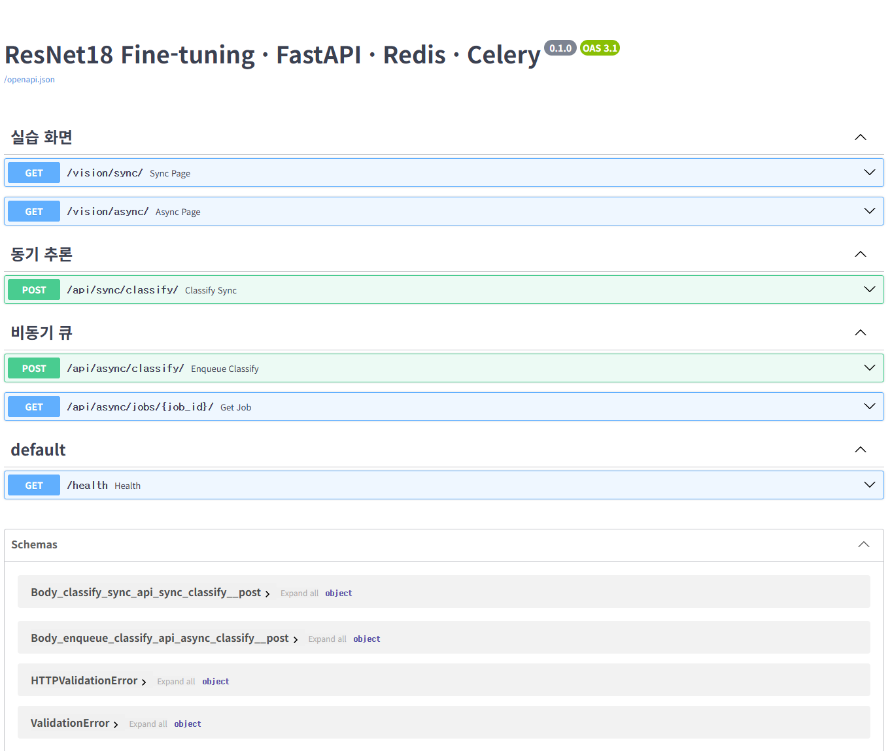

# 산출물 3. API 명세서

- Base URL: `http://127.0.0.1:8000`
- 자동 문서: `/docs` (Swagger UI), `/openapi.json`
- 응답 형식: JSON (`/vision/*`는 HTML)
- 모든 응답 예시는 **실제 실행 결과**이다. 오류 응답 중 실제로 실행하지 않고 코드·모의 테스트로만 확인한 항목은 따로 표시했다.



---

## 1. API 목록

| API ID | Method | URL | 요청 형태 | 성공 HTTP | 주요 응답 | 실패 HTTP |
|---|---|---|---|---:|---|---|
| API-01 | GET | `/health` | 없음 | 200 | `status` | 서버 미실행 시 HTTP 응답 없음 (연결 실패) |
| API-02 | POST | `/api/sync/classify/` | `multipart/form-data` / `image` | 200 | `model_id`, `top1`, `all`, `inference_ms`, `cache_hit` | 400, 413 |
| API-03 | POST | `/api/async/classify/` | `multipart/form-data` / `image` | **202** | `job_id`, `status`, `check_url` | 400, 413, 503 |
| API-04 | GET | `/api/async/jobs/{job_id}/` | 경로 변수 `job_id` (정수) | 200 | `status`, `top1`, `all`, `inference_ms`, `cache_hit`, `error_message` | 404 |
| WEB-01 | GET | `/vision/sync/` | 없음 | 200 | HTML (동기 화면) | — |
| WEB-02 | GET | `/vision/async/` | 없음 | 200 | HTML (비동기 화면) | — |
| WEB-00 | GET | `/` | 없음 | 307 | `/vision/sync/`로 이동 (코드 기준) | — |

> **핵심 구분**: API-03의 **202는 "작업 접수"** 이고, 분석이 끝났다는 뜻이 아니다. 분석 완료는 API-04 응답의 `status`가 **`done`** 일 때다.

---

## 2. API-01 헬스 체크

| 항목 | 내용 |
|---|---|
| URL / Method | `/health` / GET |
| 용도 | 서버 실행 확인, Docker `web` healthcheck에서도 사용 |

```json
{"status": "ok"}
```

서버가 꺼져 있으면 HTTP 응답 자체가 없다.

```text
curl: (7) Failed to connect to 127.0.0.1 port 8000 after 0 ms: Could not connect to server
```

---

## 3. API-02 동기 분류

| 항목 | 내용 |
|---|---|
| URL / Method | `/api/sync/classify/` / POST |
| Content-Type | `multipart/form-data` |
| 요청 필드 | `image`: JPEG / PNG / WEBP, **5MB 이하**, 최대 1,200만 픽셀 |
| 처리 | 크기 확인 → `classify_with_cache()` → 캐시 HIT면 저장 결과 반환, MISS면 모델 추론 후 캐시에 600초 저장 |
| 성공 | **200 OK** — 추론 결과가 응답에 포함됨 |
| 오류 | 400 잘못된 이미지, 413 크기 초과 |

### 응답 필드

| 필드 | 타입 | 설명 |
|---|---|---|
| `model_id` | string | 사용한 모델 경로 (`artifacts/beans_resnet18`) |
| `top1` | object | 가장 높은 점수의 `{label, score}` |
| `all` | array | 전체 클래스의 `{label, score}`, 점수 내림차순 |
| `inference_ms` | number \| null | 실제 모델 추론 시간. **캐시 HIT이면 `null`** (0ms가 아니라 추론 생략) |
| `cache_hit` | boolean | Redis 캐시 결과 재사용 여부 |

### 성공 응답 — 캐시 MISS (실제: `healthy_test.39.jpg`)

```json
{
  "model_id": "artifacts/beans_resnet18",
  "top1": {"label": "healthy", "score": 0.8065634369850159},
  "all": [
    {"label": "healthy", "score": 0.8065634369850159},
    {"label": "bean_rust", "score": 0.12289466708898544},
    {"label": "angular_leaf_spot", "score": 0.0705418810248375}
  ],
  "inference_ms": 2083.43,
  "cache_hit": false
}
```

> 2083ms는 web 컨테이너가 받은 첫 요청이라 **모델 로딩 시간이 포함**된 값이다. 워밍업 이후 MISS 추론은 중앙값 28.94ms ([산출물 6](06_성능비교_보고서.md)).

### 성공 응답 — 캐시 HIT (같은 이미지 재요청)

```json
{
  "model_id": "artifacts/beans_resnet18",
  "top1": {"label": "healthy", "score": 0.8065634369850159},
  "all": [
    {"label": "healthy", "score": 0.8065634369850159},
    {"label": "bean_rust", "score": 0.12289466708898544},
    {"label": "angular_leaf_spot", "score": 0.0705418810248375}
  ],
  "inference_ms": null,
  "cache_hit": true
}
```

### 오류 응답

| HTTP | 조건 | `detail` 메시지 | 확인 방법 |
|---:|---|---|---|
| 400 | 이미지로 열 수 없는 파일 (`.txt` 등) | `올바른 이미지 파일이 아닙니다.` | **실환경** (`bad.txt`) + 모의 |
| 400 | JPEG/PNG/WEBP가 아닌 이미지 | `JPG, PNG, WEBP 이미지만 허용합니다.` | 코드 기준 (미실시) |
| 400 | 해상도 1,200만 픽셀 초과 | `이미지 해상도가 너무 큽니다(최대 1200만 픽셀).` | 코드 기준 (미실시) |
| 400 | 빈 파일 | `이미지 파일은 1바이트 이상, 5MB 이하이어야 합니다.` | 코드 기준 (미실시) |
| 413 | 5MB 초과 | `5MB 이하 파일만 허용합니다.` | **실환경** (6MB 파일, 상태코드 확인) + 모의 |
| 422 | `image` 필드 누락 | FastAPI 기본 검증 오류 | 프레임워크 동작 (미실시) |

```json
{"detail": "올바른 이미지 파일이 아닙니다."}
```

> Redis 장애 시에도 API-02는 실패하지 않는다. `cache_service.py`가 캐시 조회 실패를 경고로만 남기고 모델 추론을 계속한다. Redis 정지 상태에서 **200, `cache_hit: false`, `inference_ms: 32.99`** 를 실제로 확인했다.

---

## 4. API-03 비동기 작업 접수

| 항목 | 내용 |
|---|---|
| URL / Method | `/api/async/classify/` / POST |
| Content-Type | `multipart/form-data` |
| 요청 필드 | `image`: API-02와 같은 조건 |
| 처리 | 크기 확인 → 이미지 유효성 검사(`load_rgb_image`) → `media/jobs/<uuid>.bin` 저장 → DB `queued` 행 생성 → `classify_job.delay(job_id)` |
| 성공 | **202 Accepted** — 결과 없이 작업 번호만 반환 |
| 오류 | 400, 413, **503** (브로커 연결 실패) |

### 성공 응답 (실제: `bean_rust_test.35.jpg`)

```json
{"job_id": 1, "status": "queued", "check_url": "/api/async/jobs/1/"}
```

### 오류 응답

| HTTP | 조건 | `detail` 메시지 | 확인 방법 |
|---:|---|---|---|
| 400 | 이미지로 열 수 없는 파일 | `올바른 이미지 파일이 아닙니다.` | **실환경** (`bad.txt`) |
| 413 | 5MB 초과 | `5MB 이하 파일만 허용합니다.` | **실환경** (6MB 파일, 상태코드 확인) |
| 503 | Redis 브로커 연결 실패 | `작업 큐 등록 실패: Redis 연결을 확인하세요.` | **실환경** (Redis 정지) + 모의 |

```json
{"detail": "작업 큐 등록 실패: Redis 연결을 확인하세요."}
```

> 503일 때도 DB 행은 이미 만들어진 뒤라, 해당 작업은 `failed`로 기록된다 (실제 job 16). 400·413은 DB 행을 만들기 전에 거절되므로 기록이 남지 않는다.

---

## 5. API-04 작업 상태 조회

| 항목 | 내용 |
|---|---|
| URL / Method | `/api/async/jobs/{job_id}/` / GET |
| 경로 변수 | `job_id`: 정수 (API-03 응답의 값) |
| 처리 | PostgreSQL `image_jobs`에서 해당 행 조회 |
| 성공 | **200 OK** — 현재 상태 반환 (`queued` / `running` / `done` / `failed`) |
| 오류 | 404 없는 작업 번호 |

### 응답 필드

| 필드 | 타입 | 설명 |
|---|---|---|
| `job_id` | integer | 작업 번호 |
| `status` | string | `queued` → `running` → `done` / `failed` |
| `model_id` | string | 모델 경로 |
| `top1` | object \| null | `status = done`일 때만 값이 있음 |
| `all` | array \| null | `status = done`일 때만 값이 있음 |
| `inference_ms` | number \| null | 실제 추론 시간, 캐시 HIT이면 `null` |
| `cache_hit` | boolean \| null | 캐시 재사용 여부, 처리 전이면 `null` |
| `error_message` | string \| null | `status = failed`일 때만 값이 있음 |

> 필드 이름 주의: 응답은 **`all`**, DB 컬럼은 **`all_scores`** 이다. 응답 필드 이름을 바꾸지 않았다.

### 처리 전 — `queued` (실제: worker 정지 중 job 5)

```json
{"job_id": 5, "status": "queued", "model_id": "artifacts/beans_resnet18",
 "top1": null, "all": null, "inference_ms": null, "cache_hit": null, "error_message": null}
```

### 완료 — `done`, 캐시 MISS (실제: job 1)

```json
{
  "job_id": 1,
  "status": "done",
  "model_id": "artifacts/beans_resnet18",
  "top1": {"label": "bean_rust", "score": 0.43883833289146423},
  "all": [
    {"label": "bean_rust", "score": 0.43883833289146423},
    {"label": "healthy", "score": 0.43562304973602295},
    {"label": "angular_leaf_spot", "score": 0.1255386620759964}
  ],
  "inference_ms": 2172.36,
  "cache_hit": false,
  "error_message": null
}
```

### 완료 — `done`, 캐시 HIT (실제: 같은 이미지로 접수한 job 2)

```json
{"job_id": 2, "status": "done", "model_id": "artifacts/beans_resnet18",
 "top1": {"label": "bean_rust", "score": 0.43883833289146423},
 "all": [{"label": "bean_rust", "score": 0.43883833289146423},
         {"label": "healthy", "score": 0.43562304973602295},
         {"label": "angular_leaf_spot", "score": 0.1255386620759964}],
 "inference_ms": null, "cache_hit": true, "error_message": null}
```

### 오류 응답 — 404

```json
{"detail": "해당 작업이 없습니다."}
```

> `running` 상태는 작업이 수십 ms~2초 안에 끝나 조회 시점에 직접 보지 못했다. 정상 처리 여부는 최종 `done` 결과, DB 행, worker 로그(`received` → `succeeded`)로 확인했다.

---

## 6. 웹 화면 (WEB-01, WEB-02)

| 화면 | 버튼 | 호출 API | 화면 표시 |
|---|---|---|---|
| `/vision/sync/` | `동기 분류` | API-02 | `HTTP 200 / 응답까지 OOms` + 결과 JSON |
| `/vision/async/` | `Celery 작업 등록` | API-03 → API-04 (1초마다, 최대 60회) | `접수 OOms / 전체 OOms / 상태 done` + 결과 JSON |
| `/vision/async/` | `상태조회 중지` | 없음 | 폴링만 멈춤, worker 작업은 계속 진행 |

---

## 7. 실행 근거

| 검증 ID | 테스트 입력 | 기대 | 실제 | 구분 | 증빙 |
|---|---|---:|---:|---|---|
| API-01-T01 | GET `/health` | 200 | 200 `{"status":"ok"}` | 실환경 | [health.png](evidence/health.png) |
| API-01-T02 | 서버 정지 상태 요청 | 응답 없음 | 연결 실패 | 실환경 | [server_down.png](evidence/server_down.png) |
| API-02-T01 | `healthy_test.39.jpg` 1회차 | 200 MISS | 200, `cache_hit: false` | 실환경 | [sync_cache_miss_hit.png](evidence/sync_cache_miss_hit.png) |
| API-02-T02 | 같은 이미지 2회차 | 200 HIT | 200, `cache_hit: true` | 실환경 | [sync_cache_miss_hit.png](evidence/sync_cache_miss_hit.png) |
| API-02-T03 | `bad.txt` | 400 | 400 | 실환경 | [sync_400.png](evidence/sync_400.png) |
| API-02-T04 | 6MB 파일 | 413 | 413 | 실환경 | [real_413_400.png](evidence/real_413_400.png) |
| API-02-T05 | Redis 정지 후 이미지 | 200 (폴백) | 200, `cache_hit: false` | 실환경 | [redis_stop_fallback_503.png](evidence/redis_stop_fallback_503.png) |
| API-03-T01 | `bean_rust_test.35.jpg` | 202 | 202, `job_id: 1` | 실환경 | [async_202.png](evidence/async_202.png) |
| API-03-T02 | `bad.txt` | 400 | 400 | 실환경 | [real_413_400.png](evidence/real_413_400.png) |
| API-03-T03 | 6MB 파일 | 413 | 413 | 실환경 | [real_413_400.png](evidence/real_413_400.png) |
| API-03-T04 | Redis 정지 후 이미지 | 503 | 503 | 실환경 | [redis_stop_fallback_503.png](evidence/redis_stop_fallback_503.png) |
| API-04-T01 | `job_id=1` | 200 done | 200 done, MISS | 실환경 | [async_done_log_404.png](evidence/async_done_log_404.png) |
| API-04-T02 | `job_id=2` | 200 done | 200 done, HIT | 실환경 | [async_cache_hit.png](evidence/async_cache_hit.png) |
| API-04-T03 | worker 정지 중 `job_id=5` | 200 queued | 200 queued | 실환경 | [worker_stopped_queued.png](evidence/worker_stopped_queued.png) |
| API-04-T04 | `job_id=999999` | 404 | 404 | 실환경 | [async_done_log_404.png](evidence/async_done_log_404.png) |
| WEB-T01 | `/vision/sync/` 업로드 (01 단계) | 200 화면 | 결과 표시 | 실환경 | [ui_sync_01_healthy.png](evidence/ui_sync_01_healthy.png) |
| WEB-T02 | `/vision/async/` 업로드 | 202 → done | 접수 19ms / 전체 1039ms / done | 실환경 | [ui_async.png](evidence/ui_async.png) |
| 전체 | `tests/test_api.py` | 4 passed | 4 passed | **모의** | [pytest_passed.png](evidence/pytest_passed.png) |
