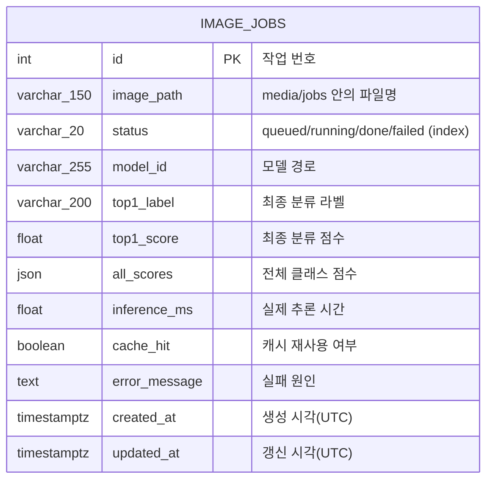
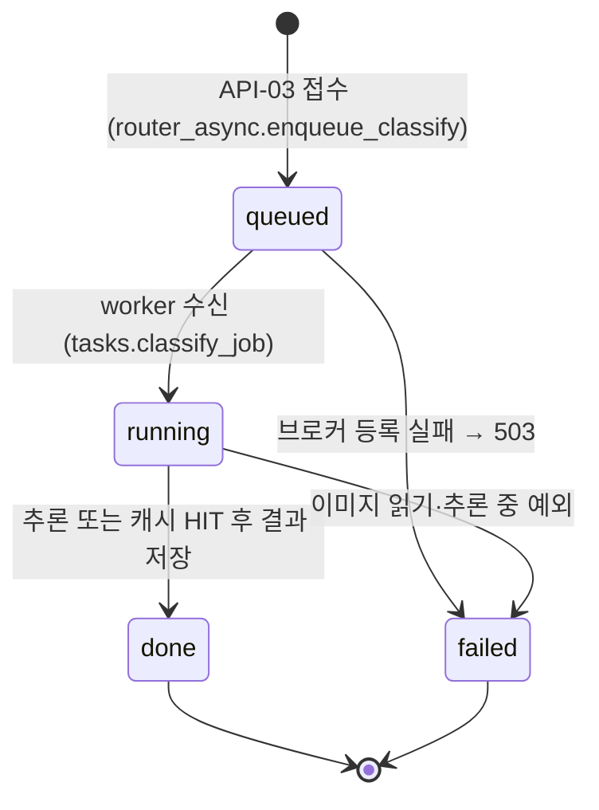

# 산출물 4. 데이터베이스 구조 및 작업이력

| 항목 | 내용 |
|---|---|
| DBMS | PostgreSQL 17 (Docker `postgres:17-alpine`) |
| DB / 사용자 | `vision_db` / `vision_user` |
| 테이블 | **`image_jobs`** (1개) |
| PK | `id` |
| 저장 대상 | **비동기** 추론 작업의 상태와 결과 |
| 생성 방식 | web 시작 시 `init_db()` → SQLAlchemy `Base.metadata.create_all()` |
| 정의 파일 | `ai/models.py`, `ai/database.py` |

> 테이블이 하나뿐이라 FK나 관계 테이블은 없다. 동기 요청(API-02)은 기본 제공 코드에서 DB에 기록하지 않는다.

---

## 1. 테이블 구조



아래 자료형·NULL 여부는 실제 DB에서 `\d image_jobs`로 확인한 값이다 ([db_schema.png](evidence/db_schema.png)).

| 컬럼 | SQLAlchemy 정의 | PostgreSQL 자료형 (`\d` 확인) | NULL | 기본값 (Python 측) | 실제 예시 | 용도 |
|---|---|---|:---:|---|---|---|
| `id` | `Integer, primary_key` | integer | NOT NULL | 시퀀스 `image_jobs_id_seq` (DB 측) | `1` | 작업 번호, API의 `job_id` |
| `image_path` | `String(150)` | character varying(150) | NOT NULL | — | `<uuid4 hex>.bin` | worker가 읽을 업로드 파일 이름 |
| `status` | `String(20), index` | character varying(20) | NOT NULL | `queued` | `done` | 처리 상태 (조회용 인덱스) |
| `model_id` | `String(255)` | character varying(255) | NOT NULL | `""` | `artifacts/beans_resnet18` | 어떤 모델로 처리했는지 |
| `top1_label` | `String(200)` | character varying(200) | NULL | — | `bean_rust` | 최종 분류 라벨 |
| `top1_score` | `Float` | double precision | NULL | — | `0.4388` | 최종 분류 점수 |
| `all_scores` | `JSON` | json | NULL | — | `[{"label":"bean_rust","score":0.4388}, …]` | 전체 클래스 점수 (API 응답의 `all`) |
| `inference_ms` | `Float` | double precision | NULL | — | `2172.36` / NULL | 실제 추론 시간, 캐시 HIT이면 NULL |
| `cache_hit` | `bool` | boolean | NULL | — | `f` / `t` | Redis 캐시 재사용 여부 |
| `error_message` | `Text` | text | NULL | — | `작업 큐 등록 실패: …` | 실패 원인 |
| `created_at` | `DateTime(timezone=True)` | timestamp with time zone | NOT NULL | `utcnow()` | `2026-11-04 02:41:40+00` | 접수 시각 |
| `updated_at` | `DateTime(timezone=True)` | timestamp with time zone | NOT NULL | `utcnow()`, 갱신 시 자동 | — | 마지막 상태 변경 시각 |

- **기본값은 DB가 아니라 SQLAlchemy(Python)가 넣는다.** 실제로 `\d image_jobs`의 Default 칸에는 `id`의 시퀀스(`nextval`)만 있고, `status`·`model_id`·`created_at`의 기본값은 표시되지 않는다.
- 인덱스: `image_jobs_pkey` (PK, `id`), `ix_image_jobs_status` (`status`) — `models.py`의 `index=True`와 일치한다.
- **시각은 UTC로 저장**된다. 예를 들어 `02:41:40+00`은 한국 시간 11:41:40이다.
- 응답 필드 `all`과 DB 컬럼 `all_scores`는 이름이 다르다. `router_async.py`의 `get_job()`이 변환한다.

---

## 2. 상태 전이



| 전이 | 기록하는 코드 | 실제 관찰 |
|---|---|---|
| → `queued` | `router_async.py` `enqueue_classify()` | ✅ job 5 (worker 정지 중 조회) |
| `queued` → `failed` (503) | `router_async.py` 예외 처리 | ✅ **job 16** (Redis 정지) |
| `queued` → `running` | `tasks.py` `classify_job()` | ⚠️ 처리가 빨라 조회로는 직접 보지 못함. worker 로그의 `received`로 시작을 확인 |
| `running` → `done` | `tasks.py` | ✅ job 1~5, 17 등 |
| `running` → `failed` (worker 예외) | `tasks.py` 예외 처리 | 모의 테스트로만 확인 (`test_worker_failure_records_failed`), 실환경 미발생 |

> `tasks.py`는 이미 `done`인 작업을 다시 받으면 처리하지 않고 바로 끝낸다(중복 처리 방지).

---

## 3. 작업이력 조회

```sql
SELECT id, status, top1_label, top1_score, cache_hit, inference_ms, created_at
FROM image_jobs
ORDER BY id;
```

### 3-1. 기능 검증 중 생성된 작업

| id | status | top1_label | top1_score | cache_hit | inference_ms | 생성 경위 | 판정 |
|---:|---|---|---:|---|---:|---|---|
| 1 | done | bean_rust | 0.4388 | f | 2172.36 | curl 접수 (bean_rust_test.35) | 실제 추론 (worker 첫 작업, 모델 로딩 포함) |
| 2 | done | bean_rust | 0.4388 | t | NULL | 같은 이미지 재접수 | 캐시 결과 재사용 |
| 3 | done | bean_rust | 0.4388 | t | NULL | 같은 이미지 재접수 | 캐시 결과 재사용 |
| 4 | done | angular_leaf_spot | 0.5146 | f | 19.78 | 웹 화면 접수 (angular_leaf_spot_test.10) | 실제 추론 |
| 5 | done | healthy | 0.7499 | f | 2155.8 | worker 정지 중 접수 → 재시작 후 처리 | 재시작으로 모델 재로딩 |
| 6 | done | bean_rust | — | f | 24.7 | 성능 측정 비동기 MISS (bean_rust_test.24) | 실제 추론 |
| 7 | done | bean_rust | — | f | 28.01 | 성능 측정 비동기 MISS (bean_rust_test.35) | 실제 추론 (측정 전 캐시 초기화) |
| 8 | done | bean_rust | — | f | 22.6 | 성능 측정 비동기 MISS (bean_rust_test.8) | 실제 추론 |
| 9 | done | healthy | — | f | 24.24 | 성능 측정 비동기 MISS (healthy_test.18) | 실제 추론 |
| 10 | done | healthy | — | f | 23.48 | 성능 측정 비동기 MISS (healthy_test.29) | 실제 추론 |
| 11~15 | done | job 6~10과 동일 | — | t | NULL | 성능 측정 비동기 HIT (같은 5장 재요청) | 캐시 결과 재사용 |
| 16 | **failed** | NULL | NULL | NULL | NULL | Redis 정지 중 접수 | **503, `작업 큐 등록 실패: Redis 연결을 확인하세요.`** |
| 17 | done | healthy | 0.6068 | f | 55.11 | Redis 재시작 후 접수 | 복구 확인 (worker 재연결, 모델 유지) |

> job 2·3의 점수가 job 1과 소수점까지 같은 이유는 Redis에 저장된 결과를 그대로 가져왔기 때문이다. job 6~15의 라벨·`cache_hit`·`inference_ms`는 `data/timings.csv`의 `job_id` 열에서 옮겼다 (점수는 CSV에 없어 `—`로 표시).

### 3-2. 관찰 포인트

1. **캐시 HIT 행은 `inference_ms`가 NULL**이다. 추론 시간이 0이라는 뜻이 아니라 추론을 건너뛰었다는 뜻이다.
2. **`inference_ms`로 모델 로딩 시점을 알 수 있다.** worker의 첫 작업(job 1)과 재시작 직후 작업(job 5)은 2초대, 모델이 메모리에 있는 상태(job 4, 17)는 수십 ms였다.
3. **job 17(55.11ms)은 Redis만 재시작했을 때**의 결과다. worker 프로세스는 살아 있어 모델을 다시 로드하지 않았다.

---

## 4. 이미지 저장 방식

| 항목 | 내용 |
|---|---|
| 저장 위치 | `media/jobs/<uuid4 hex>.bin` (호스트 폴더를 web·worker가 볼륨으로 공유) |
| DB에 저장하는 것 | 파일 **이름**만 (`image_path`), 이미지 바이너리는 저장하지 않음 |
| 파일 이름 규칙 | 사용자가 보낸 파일명은 쓰지 않고 무작위 UUID 사용 (경로 조작 방지) |
| 확인 | 평가 중 `media/jobs/`에 `.bin` 파일 생성 확인 (job 1~15 시점 15개) |
| 저장소 제외 | `.gitignore`의 `media/jobs/*` |

> **관찰된 한계**: 503(job 16)처럼 큐 등록이 실패해도, 이미지 파일은 DB 행보다 **먼저** 저장되므로 `media/jobs/`에 남는다. 실패 작업의 파일을 정리하는 기능은 기본 코드에 없다.

---

## 5. 증빙

| 내용 | 파일 |
|---|---|
| 작업이력 (job 1~3) | [evidence/db_rows.png](evidence/db_rows.png) |
| `failed` 행 (job 16) | [evidence/db_failed_row.png](evidence/db_failed_row.png) |
| `queued` 상태 (job 5) | [evidence/worker_stopped_queued.png](evidence/worker_stopped_queued.png) |
| 업로드 파일 | [evidence/media_jobs_bin.png](evidence/media_jobs_bin.png) |
| 테이블 정의 (`\d image_jobs`) | [evidence/db_schema.png](evidence/db_schema.png) |
