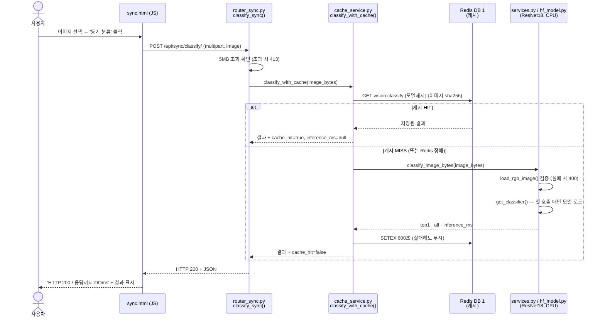
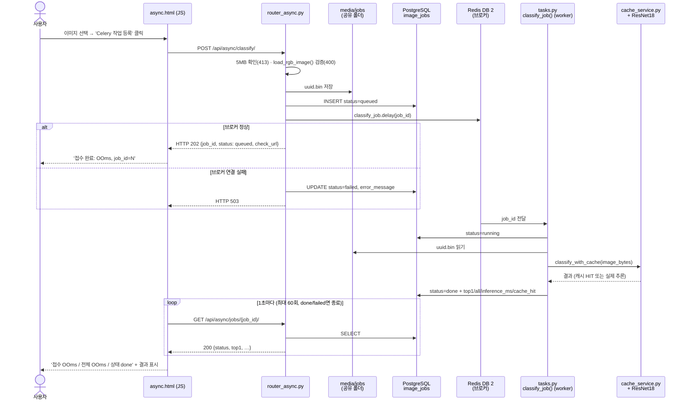

# 산출물 5. AI 분석 버튼 처리 파이프라인

사용자가 화면에서 버튼을 누른 뒤 어떤 파일·함수가 어떤 순서로 실행되는지 정리한다. 모든 단계는 실제 코드와 실행 로그로 대조했다. 아래 실행 예시는 필수 검증 단계(A. Head-only)에서 수집했으며, 최종 서비스 모델(C)로 교체한 뒤에도 같은 흐름으로 동작함을 확인했다 (D-4).

---

## A. 동기 버튼 (`/vision/sync/` → `동기 분류`)



**동기 방식의 특징**: HTTP 응답을 받는 순간 분류 결과가 들어 있다. 대신 추론이 끝날 때까지 사용자는 기다린다.

---

## B. 비동기 버튼 (`/vision/async/` → `Celery 작업 등록`)



**비동기 방식의 특징**: 202 응답은 "접수했다"는 뜻이고 결과는 없다. 사용자는 바로 응답을 받고, 무거운 추론은 worker가 따로 처리한다. 결과는 상태 조회(폴링)로 가져온다.

> `상태조회 중지` 버튼은 **브라우저의 폴링만** 멈춘다. worker의 작업은 계속 진행된다.

---

## C. 단계별 코드 대응표

| 단계 | 파일 | 함수·처리 | 반환 / 다음 단계 |
|---|---|---|---|
| 동기 1 | `templates/sync.html` | `fetch('/api/sync/classify/')` | API-02 호출, 응답 시간 측정 |
| 동기 2 | `ai/router_sync.py` | `classify_sync()` — 5MB 확인 | 413 또는 `classify_with_cache()` |
| 동기 3 | `ai/cache_service.py` | `classify_with_cache()` — `cache_key()`로 Redis 조회 | HIT: 저장 결과 / MISS: `classify_image_bytes()` |
| 동기 4 | `ai/services.py` | `load_rgb_image()` → `get_classifier()(image, top_k=5)` | `top1`, `all`, `inference_ms` |
| 동기 5 | `ai/hf_model.py` | `get_classifier()` — `pipeline(..., device=-1)`, `lru_cache` | 프로세스당 1회 로드 후 재사용 |
| 비동기 1 | `templates/async.html` | `fetch('/api/async/classify/')` | API-03 호출 |
| 비동기 2 | `ai/router_async.py` | `enqueue_classify()` — 검증, 파일 저장, DB `queued`, `classify_job.delay()` | 202 / 400 / 413 / 503 |
| 비동기 3 | `ai/celery_app.py` | Celery 앱 (브로커 DB 2, 결과 DB 3) | 메시지를 worker로 전달 |
| 비동기 4 | `ai/tasks.py` | `classify_job(job_id)` — `running` → 파일 읽기 → `classify_with_cache()` → `done` | 예외 시 `failed` |
| 비동기 5 | `templates/async.html` | 1초 간격 `fetch(check_url)` | `done` / `failed`에서 종료 |
| 비동기 6 | `ai/router_async.py` | `get_job(job_id)` | 상태·결과 JSON, 없으면 404 |

---

## D. 실제 실행으로 확인한 흐름

### D-1. 동기 (Docker)

| 순서 | 입력 | 결과 |
|---|---|---|
| 1회차 | `healthy_test.39.jpg` | 200, healthy 0.8066, `cache_hit: false`, `inference_ms` 2083.43 (web 첫 요청, 모델 로딩 포함) |
| 2회차 | 같은 이미지 | 200, 같은 결과, `cache_hit: true`, `inference_ms: null` |

### D-2. 비동기 (worker 로그와 대조)

```text
[02:41:39] curl → HTTP 202 {"job_id":1,"status":"queued"}
[02:41:40,498] Task ai.classify_job[74e1c128-…] received
[02:41:42,678] Device set to use cpu                      ← worker에서 모델 첫 로드
[02:41:42,718] Task ai.classify_job[74e1c128-…] succeeded in 2.22s: {'job_id': 1, 'status': 'done'}
→ GET /api/async/jobs/1/ : done, bean_rust 0.4388, inference_ms 2172.36
```

(로그 시각은 UTC, 한국 시간 +9시간)

### D-3. 웹 화면 비동기 (job 4)

- 화면 표시: **접수 19ms / 전체 1039ms / 상태 done**
- 실제 추론: `inference_ms` **19.78** (worker가 이미 모델을 로드한 상태)
- 전체 1039ms의 대부분은 `async.html`이 접수 후 **1초를 기다린 다음** 첫 조회를 하기 때문이다. 처리 자체는 훨씬 빨리 끝났다.

### D-4. 예외 흐름

| 상황 | 흐름 | 결과 |
|---|---|---|
| worker 정지 | 접수(202) → 브로커에 메시지 보관 → worker 재시작 | 재시작 3ms 후 `received` → job 5 `done` |
| Redis 정지 (동기) | 캐시 조회 실패 → 경고 후 모델 추론 | 200, `cache_hit: false` |
| Redis 정지 (비동기) | DB `queued` 생성 → `delay()` 실패 → `failed` | 503, job 16 `failed` |
| Redis 복구 | worker 자동 재연결 (`Trying again … (4/100)` → `Connected`) | job 17 `done` |
| 서비스 모델 교체 | `.env` 변경 → `--force-recreate web worker` → worker 첫 작업에서 새 모델 로드 | job 24 `done` (2529ms), `model_id` 변경 |

---

## E. 비교 결론

| 구분 | 동기 | 비동기 |
|---|---|---|
| HTTP 응답에 결과 포함 | ✅ 포함 (200) | ❌ 작업 번호만 (202) |
| 결과 받는 방법 | 응답 그대로 | 상태 조회 반복 (폴링) |
| 사용자 대기 | 추론이 끝날 때까지 | 접수 즉시 응답 |
| 추론 실행 위치 | web 컨테이너 | worker 컨테이너 |
| DB 기록 | 없음 | `image_jobs`에 상태·결과 |
| Redis 장애 시 | 캐시 없이 계속 동작 | 접수 실패 (503) |
| 사용 모델 | `MODEL_PATH`의 같은 모델 (최종: `beans_resnet18_full_lr5e-5`) | `MODEL_PATH`의 같은 모델 (최종: `beans_resnet18_full_lr5e-5`) |

**분류를 수행하는 ResNet18 모델과 캐시 로직은 두 방식이 똑같다.** 차이는 "누가, 언제 추론하고, 결과를 어떻게 전달하느냐"에 있다. 실제 시간 비교는 [산출물 6](06_성능비교_보고서.md)에 정리했다.

---

## F. 증빙

| 내용 | 파일 |
|---|---|
| 동기 화면 (01 단계) | [evidence/ui_sync_01_healthy.png](evidence/ui_sync_01_healthy.png) |
| 동기 MISS → HIT (Docker) | [evidence/sync_cache_miss_hit.png](evidence/sync_cache_miss_hit.png) |
| 비동기 화면 | [evidence/ui_async.png](evidence/ui_async.png) |
| 비동기 접수·완료·worker 로그 | [evidence/async_202.png](evidence/async_202.png) · [evidence/async_done_log_404.png](evidence/async_done_log_404.png) |
| worker 정지·재시작 | [evidence/worker_stop.png](evidence/worker_stop.png) · [evidence/worker_restarted_done.png](evidence/worker_restarted_done.png) |
| Redis 장애·복구 | [evidence/redis_stop_fallback_503.png](evidence/redis_stop_fallback_503.png) · [evidence/worker_reconnect.png](evidence/worker_reconnect.png) · [evidence/recovery_done.png](evidence/recovery_done.png) |
