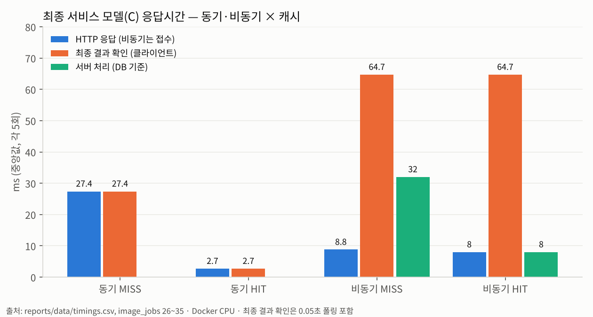

# 산출물 6. 성능 측정 및 비교 보고서

## 1. 측정 목적

동기·비동기 처리 방식과 Redis 캐시가 **응답 시간, 결과 확인 시간, 모델 추론 시간**에 어떤 차이를 만드는지 같은 조건에서 반복 측정해 비교한다.

같은 측정을 **두 번** 했다.

| 회차 | 서비스 모델 (`MODEL_PATH`) | 원본 | 역할 |
|---|---|---|---|
| 1차 | A. Head-only (`artifacts/beans_resnet18`) | [data/timings_headonly.csv](data/timings_headonly.csv) | 필수 검증 단계 측정 |
| **2차** | **C. Full lr 5e-5 (`artifacts/beans_resnet18_full_lr5e-5`)** | [data/timings.csv](data/timings.csv) | **최종 서비스 모델 측정 (대표값)** |

두 모델은 **구조가 같은 ResNet18**이고 학습된 가중치 값만 다르다. 따라서 계산량(추론 비용)은 같다고 보며, 2차 측정은 "모델 교체 후에도 같은 결론이 나오는지"를 확인하는 재현 실험이기도 하다.

## 2. 지표 정의

| 지표 | 정의 | 측정 위치 |
|---|---|---|
| `http_ms` | POST 요청을 보내고 HTTP 응답을 받을 때까지. 동기는 결과 포함 응답, 비동기는 **202 접수 응답** | 클라이언트 (`time.perf_counter`) |
| `final_ms` | POST 시작부터 **결과를 손에 쥘 때까지**. 동기는 `http_ms`와 같고, 비동기는 상태 조회에서 `done`을 받은 시점 | 클라이언트 |
| `inference_ms` | 서버 안에서 모델이 실제로 추론한 시간 (`services.py`) | 서버 응답 값 |
| 서버 처리 (DB) | 비동기 작업의 `updated_at − created_at` = `queued` 행 생성 → `done` 기록 | PostgreSQL |

> `inference_ms = NULL`은 캐시 HIT로 **추론을 건너뛰었다**는 뜻이며 0ms가 아니다.

## 3. 측정 조건

| 조건 | 값 |
|---|---|
| 측정 도구 | `reports/measure_timings.py` (제공 코드 수정 없이 API만 호출하는 측정 스크립트, `httpx`) |
| 클라이언트 | WSL2 호스트에서 `http://127.0.0.1:8000`으로 요청 |
| 서버 | Docker `web`·`worker` 컨테이너, **CPU 추론** (torch 2.5.1+cpu) |
| 하드웨어 | Intel Core i7-12700 (20 스레드), WSL 할당 RAM 15GiB, Windows 11 Pro + WSL2 Ubuntu 26.04.1 |
| Worker | Celery `solo`, `concurrency=1` |
| 반복 | 조건별 **5회**, 대표값은 **중앙값** |
| 이미지 | `dataset/test/*/*.jpg`를 정렬해 12장 간격으로 10장 선택. **동기용 5장 / 비동기용 5장을 따로** 사용 (캐시를 공유하므로). **1차·2차 모두 같은 10장** |
| 캐시 MISS 보장 | 측정 직전 `redis-cli -n 1 FLUSHDB`로 **캐시 DB(1번)만** 비움. 브로커(2번)는 건드리지 않음 |
| 캐시 HIT 조건 | MISS 측정에 쓴 같은 5장을 그대로 다시 요청 |
| 워밍업 | 측정 전에 web·worker 모두 모델을 이미 로드한 상태. 모델 첫 로딩 시간은 **비교에서 제외**하고 4-5에 따로 기록 |
| 비동기 결과 확인 | **0.05초 간격 폴링** (웹 화면의 1초 간격보다 정밀). 최대 50ms의 폴링 오차 포함 가능 |
| 측정 순서 | 동기 MISS 5 → 동기 HIT 5 → 비동기 MISS 5 → 비동기 HIT 5 |

## 4. 측정 결과

### 4-1. 원본 측정값 — 2차 (최종 서비스 모델 C)

| path | cache | run | image (정답) | http_ms | final_ms | inference_ms | top1 | job_id |
|---|---|---:|---|---:|---:|---:|---|---:|
| sync | MISS | 1 | angular_leaf_spot_test.0 (angular) | 50.4 | 50.4 | 39.90 | angular_leaf_spot | — |
| sync | MISS | 2 | angular_leaf_spot_test.2 (angular) | 33.8 | 33.8 | 25.73 | angular_leaf_spot | — |
| sync | MISS | 3 | angular_leaf_spot_test.30 (angular) | 24.1 | 24.1 | 18.22 | angular_leaf_spot | — |
| sync | MISS | 4 | angular_leaf_spot_test.41 (angular) | 27.4 | 27.4 | 20.74 | angular_leaf_spot | — |
| sync | MISS | 5 | bean_rust_test.13 (rust) | 22.9 | 22.9 | 16.90 | bean_rust | — |
| sync | HIT | 1 | angular_leaf_spot_test.0 | 3.1 | 3.1 | NULL | angular_leaf_spot | — |
| sync | HIT | 2 | angular_leaf_spot_test.2 | 2.8 | 2.8 | NULL | angular_leaf_spot | — |
| sync | HIT | 3 | angular_leaf_spot_test.30 | 2.7 | 2.7 | NULL | angular_leaf_spot | — |
| sync | HIT | 4 | angular_leaf_spot_test.41 | 2.6 | 2.6 | NULL | angular_leaf_spot | — |
| sync | HIT | 5 | bean_rust_test.13 | 2.6 | 2.6 | NULL | bean_rust | — |
| async | MISS | 1 | bean_rust_test.24 (rust) | 12.7 | 71.5 | 20.08 | bean_rust | 26 |
| async | MISS | 2 | bean_rust_test.35 (rust) | 10.3 | 67.2 | 19.32 | bean_rust | 27 |
| async | MISS | 3 | bean_rust_test.8 (rust) | 8.2 | 63.8 | 17.80 | bean_rust | 28 |
| async | MISS | 4 | healthy_test.18 (healthy) | 8.4 | 64.7 | 21.27 | healthy | 29 |
| async | MISS | 5 | healthy_test.29 (healthy) | 8.8 | 64.4 | 18.82 | healthy | 30 |
| async | HIT | 1 | bean_rust_test.24 | 8.0 | 65.2 | NULL | bean_rust | 31 |
| async | HIT | 2 | bean_rust_test.35 | 9.5 | 70.8 | NULL | bean_rust | 32 |
| async | HIT | 3 | bean_rust_test.8 | 9.1 | 64.7 | NULL | bean_rust | 33 |
| async | HIT | 4 | healthy_test.18 | 7.2 | 62.7 | NULL | healthy | 34 |
| async | HIT | 5 | healthy_test.29 | 8.0 | 63.9 | NULL | healthy | 35 |

- 모든 요청의 HTTP 상태는 동기 200, 비동기 202였다. MISS 행은 모두 `cache_hit=False`, HIT 행은 모두 `True`였다.
- DB의 job 26~35가 모두 `model_id = artifacts/beans_resnet18_full_lr5e-5`로 기록되어, 2차 측정이 최종 모델로 이루어졌음을 확인했다.
- 10장 모두 정답이었다. 1차(A)에서 틀린 2장(angular_leaf_spot_test.41, bean_rust_test.13)이 2차(C)에서는 맞았다. 시간 측정용 샘플이라 정확도 판단에는 쓰지 않는다.

<details>
<summary><b>4-1b. 원본 측정값 — 1차 (필수 검증 단계 A. Head-only)</b></summary>

| path | cache | run | image (정답) | http_ms | final_ms | inference_ms | top1 | job_id |
|---|---|---:|---|---:|---:|---:|---|---:|
| sync | MISS | 1 | angular_leaf_spot_test.0 (angular) | 68.7 | 68.7 | 57.50 | angular_leaf_spot | — |
| sync | MISS | 2 | angular_leaf_spot_test.2 (angular) | 41.2 | 41.2 | 28.94 | angular_leaf_spot | — |
| sync | MISS | 3 | angular_leaf_spot_test.30 (angular) | 55.6 | 55.6 | 46.35 | angular_leaf_spot | — |
| sync | MISS | 4 | angular_leaf_spot_test.41 (angular) | 35.7 | 35.7 | 26.83 | *bean_rust* | — |
| sync | MISS | 5 | bean_rust_test.13 (rust) | 33.6 | 33.6 | 27.05 | *healthy* | — |
| sync | HIT | 1 | angular_leaf_spot_test.0 | 5.9 | 5.9 | NULL | angular_leaf_spot | — |
| sync | HIT | 2 | angular_leaf_spot_test.2 | 4.8 | 4.8 | NULL | angular_leaf_spot | — |
| sync | HIT | 3 | angular_leaf_spot_test.30 | 4.3 | 4.3 | NULL | angular_leaf_spot | — |
| sync | HIT | 4 | angular_leaf_spot_test.41 | 2.5 | 2.5 | NULL | *bean_rust* | — |
| sync | HIT | 5 | bean_rust_test.13 | 2.8 | 2.8 | NULL | *healthy* | — |
| async | MISS | 1 | bean_rust_test.24 (rust) | 16.1 | 75.1 | 24.70 | bean_rust | 6 |
| async | MISS | 2 | bean_rust_test.35 (rust) | 13.4 | 72.7 | 28.01 | bean_rust | 7 |
| async | MISS | 3 | bean_rust_test.8 (rust) | 11.6 | 69.6 | 22.60 | bean_rust | 8 |
| async | MISS | 4 | healthy_test.18 (healthy) | 13.6 | 71.6 | 24.24 | healthy | 9 |
| async | MISS | 5 | healthy_test.29 (healthy) | 11.8 | 69.5 | 23.48 | healthy | 10 |
| async | HIT | 1 | bean_rust_test.24 | 9.8 | 66.9 | NULL | bean_rust | 11 |
| async | HIT | 2 | bean_rust_test.35 | 11.0 | 68.7 | NULL | bean_rust | 12 |
| async | HIT | 3 | bean_rust_test.8 | 7.7 | 64.5 | NULL | bean_rust | 13 |
| async | HIT | 4 | healthy_test.18 | 9.6 | 66.3 | NULL | healthy | 14 |
| async | HIT | 5 | healthy_test.29 | 8.3 | 64.3 | NULL | healthy | 15 |

*기울임* 표시는 오분류.

</details>

- 동기 MISS의 `http_ms − inference_ms`는 1차 약 7~12ms, 2차 약 6~11ms로, 이미지 업로드·디코딩·캐시 조회·응답 직렬화 등 추론 외 처리 시간이다.

### 4-2. 조건별 중앙값 (ms)

| 경로 | 캐시 | HTTP 응답<br>2차 (C) | 최종 결과 확인<br>2차 (C) | 모델 추론<br>2차 (C) | HTTP 응답<br>1차 (A) | 최종 결과 확인<br>1차 (A) | 모델 추론<br>1차 (A) |
|---|---|---:|---:|---:|---:|---:|---:|
| 동기 | MISS | 27.4 | 27.4 | 20.74 | 41.2 | 41.2 | 28.94 |
| 동기 | HIT | **2.7** | 2.7 | NULL | 4.3 | 4.3 | NULL |
| 비동기 | MISS | **8.8** (접수) | 64.7 | 19.32 | 13.4 (접수) | 71.6 | 24.24 |
| 비동기 | HIT | 8.0 (접수) | 64.7 | NULL | 9.6 (접수) | 66.3 | NULL |



> **1차보다 2차가 전반적으로 빠른 이유**: 두 모델은 구조가 같아 계산량이 같다. 따라서 "Full 모델이 더 빠르다"는 뜻이 아니라, **측정 회차 간 시스템 상태 차이(편차)** 로 본다. 비교와 결론은 같은 회차 안에서만 한다.

### 4-3. DB 기준 서버 처리 시간 (비동기, 폴링 영향 제외)

클라이언트의 `final_ms`는 폴링 간격의 영향을 받으므로, 비동기 작업의 실제 서버 처리 시간을 DB 시각으로 따로 계산했다.

- **정의**: `updated_at − created_at` = web이 `queued` 행을 만든 시점 → worker가 `done`을 기록한 시점
- 포함: 브로커 전달, worker의 `running` 기록, 파일 읽기, 캐시 조회, (MISS면) 추론과 캐시 저장, `done` 기록
- 제외: 업로드 수신·이미지 검증·파일 저장(접수 앞부분), 클라이언트의 상태 조회
- web과 worker 컨테이너는 같은 호스트 커널 시계를 쓰므로 두 시각을 비교할 수 있다.

```sql
SELECT id, cache_hit, round(extract(epoch FROM (updated_at - created_at))*1000)::int AS 처리_ms
FROM image_jobs WHERE id BETWEEN 26 AND 35 ORDER BY id;   -- 1차는 6~15
```

| 회차 | 캐시 | job (처리_ms) | **중앙값** | `inference_ms` 중앙값 |
|---|---|---|---:|---:|
| 2차 (C) | MISS | 26 (35) · 27 (32) · 28 (28) · 29 (32) · 30 (29) | **32 ms** | 19.32 ms |
| 2차 (C) | HIT | 31 (8) · 32 (7) · 33 (8) · 34 (7) · 35 (8) | **8 ms** | NULL |
| 1차 (A) | MISS | 6 (46) · 7 (48) · 8 (37) · 9 (39) · 10 (38) | 39 ms | 24.24 ms |
| 1차 (A) | HIT | 11 (11) · 12 (11) · 13 (8) · 14 (9) · 15 (8) | 9 ms | NULL |

- **HIT 8~9ms** ≈ 추론을 뺀 비동기 처리 구조 비용 (큐 전달 + DB 기록 2회 + 파일 읽기 + 캐시 조회)
- **MISS − HIT = 24~30ms** ≈ 모델 추론(19~24ms) + 이미지 디코딩·캐시 저장. 추론 시간과 잘 맞는다.
- 클라이언트 `final_ms`(64~72ms)와의 차이 대부분은 **폴링 대기**다.

### 4-4. 결론의 재현 (1차 vs 2차)

| 지표 | 1차 (A) | 2차 (C) | 결론 |
|---|---:|---:|---|
| 캐시 효과 (동기 응답 감소율) | 89.6% | 90.1% | 두 번 모두 약 90% |
| 동기 → 비동기 HTTP 감소율 | 67.5% | 67.9% | 두 번 모두 약 68% |
| 결과 확인 차이 (비동기 − 동기, MISS) | +30.4ms | +37.3ms | 두 번 모두 비동기가 느림 |
| 비동기 서버 처리 HIT | 9ms | 8ms | 구조 비용은 10ms 미만 |
| 비동기 `final_ms` 분포 | 64~75ms | 63~72ms | 두 번 모두 폴링 간격에 몰림 |

### 4-5. 참고: 모델 첫 로딩이 포함된 요청 (비교 제외)

| 요청 | inference_ms | 설명 |
|---|---:|---|
| 01 로컬 동기 첫 요청 (A) | 3736.14 | 로컬 uvicorn 프로세스 첫 로드 |
| Docker web 첫 동기 요청 (A) | 2083.43 | web 컨테이너 첫 로드 |
| Docker worker 첫 작업 (A, job 1) | 2172.36 | worker 컨테이너 첫 로드 |
| worker 재시작 직후 (A, job 5) | 2155.8 | 재시작으로 메모리의 모델이 사라져 다시 로드 |
| **모델 교체 후 worker 첫 작업 (C, job 24)** | **2529.36** | `--force-recreate` 후 새 모델 로드 |

> 모델은 `lru_cache`로 **프로세스마다 한 번** 로드된다. 로딩 이후 같은 CPU 추론은 수십 ms 수준이다.

## 5. 계산 (대표값 = 2차, 괄호 = 1차)

```text
① 캐시 효과 (동기 HTTP)        = (27.4 − 2.7) / 27.4 × 100  = 90.1% 감소   (1차 89.6%)
② 동기 → 비동기 HTTP 응답      = (27.4 − 8.8) / 27.4 × 100  = 67.9% 감소   (1차 67.5%)
③ 결과 확인 시간 차이 (MISS)   = 64.7 − 27.4               = +37.3 ms     (1차 +30.4 ms)
④ 결과 확인 시간 차이 (HIT)    = 64.7 − 2.7                = +62.0 ms     (1차 +62.0 ms)
⑤ 모델 추론 (MISS)             = 동기 20.74 / 비동기 19.32 ms (같은 모델, 큰 차이 없음)
⑥ 비동기 서버 처리 (DB 기준)    = MISS 32 ms / HIT 8 ms      (1차 39 / 9 ms)
⑦ 캐시 효과 (비동기 서버 처리)  = (32 − 8) / 32 × 100       = 75.0% 감소   (1차 76.9%)
```

## 6. 해석

1. **캐시 HIT는 동기 응답을 약 90% 줄였다.** 모델 추론과 이미지 디코딩을 건너뛰고 Redis에서 결과만 가져오기 때문이다. 두 회차 모두 같았다.
2. **비동기는 HTTP 응답이 약 68% 빨랐지만, 추론이 빨라진 것은 아니다.** 무거운 처리를 worker로 넘기고 `job_id`만 먼저 돌려준 효과다. 실제 모델 추론 시간은 두 방식 모두 20ms 안팎으로 비슷하다.
3. **클라이언트 기준으로는 결과를 받기까지 비동기가 더 느렸다 (+37.3ms, 1차 +30.4ms).** 하지만 이 차이의 대부분은 **폴링 대기**다. 측정 스크립트는 접수 직후 한 번 조회하고(아직 `queued`), 0.05초 쉰 뒤 다시 조회하므로, `final_ms`가 MISS·HIT 모두 **63~75ms에 몰려 있다** (≈ 접수 + 폴링 1회 간격).
4. **DB 기준 실제 서버 처리 시간은 MISS 32ms, HIT 8ms였다 (4-3).** 비동기에서만 생기는 구조 비용(큐 전달, DB 상태 기록 2회, 파일 읽기)은 HIT 기준 **10ms 미만**으로 작다. MISS와 HIT의 차이(24ms)는 추론 시간(19ms)과 잘 맞아, 캐시는 비동기에서도 추론 비용만큼을 줄인다. 반면 클라이언트 `final_ms`에서는 MISS·HIT 차이가 폴링 간격에 가려져 거의 보이지 않았다.
5. 그래서 **비동기는 결과를 받으려면 반드시 상태 조회가 필요**하고, 사용자가 체감하는 결과 시간은 서버 처리 시간보다 **폴링 간격**에 좌우된다. 짧은 작업에서는 폴링 간격을 줄이거나 WebSocket·SSE 같은 알림 방식이 필요하다 (미구현 제안).
6. 웹 화면(`async.html`)은 1초 간격으로 조회하기 때문에 화면에 보이는 "전체" 시간은 1초 이상으로 표시된다 (job 4: 접수 19ms / 전체 1039ms, 실제 추론 19.78ms).
7. **서비스 모델을 바꿔도 결론은 같았다 (4-4).** 같은 구조의 모델이라 시간 특성은 같고, 회차 간 절대값 차이는 측정 편차로 본다.

**결론**: 이번 규모(이미지 1장, 추론 수십 ms)에서는 동기 방식이 결과를 더 빨리 준다. 비동기의 서버 처리 자체는 MISS 32ms로 동기와 비슷하지만, 결과를 폴링으로 가져오는 과정에서 시간이 더 든다. 비동기의 장점은 **사용자가 즉시 응답을 받고, 추론이 오래 걸리거나 요청이 몰려도 웹 서버가 막히지 않는 구조**에 있다. 이 장점(동시 요청 처리량)은 이번에 측정하지 않았다.

## 7. 비교 조건 점검

- [x] 같은 회차 안에서는 같은 모델 체크포인트로 측정 (1차 A, 2차 C — DB `model_id`로 확인)
- [x] MISS 대 MISS, HIT 대 HIT로 구분해 비교
- [x] 같은 하드웨어·컨테이너·네트워크 경로, 1·2차 같은 이미지 10장
- [x] 모델 첫 로딩(워밍업) 제외, 별도 표기 (4-5)
- [x] 비동기 결과 확인 시간의 폴링 간격(0.05초) 명시
- [x] 반복 원본값(4-1)과 요약표(4-2) 일치 확인 (5개 값의 가운데 값으로 재계산)
- [x] 폴링 영향을 제외한 비동기 서버 처리 시간을 DB 시각으로 별도 확인 (4-3)

## 8. 한계

- 조건별 **5회**만 반복해 경향을 보는 수준이며, 통계적으로 유의한 차이를 주장하지 않는다.
- 1차와 2차의 절대값이 20~35% 차이 났다. 같은 구조의 모델인데도 회차 간 편차가 이 정도라, 회차를 넘는 절대값 비교는 하지 않는다.
- 요청을 **한 번에 하나씩** 보냈다. 여러 요청이 동시에 들어올 때의 처리량·대기 시간은 측정하지 않았다.
- 클라이언트와 서버가 같은 PC에 있어 실제 네트워크 지연은 포함되지 않았다.
- 비동기 `final_ms`는 폴링 간격만큼(최대 50ms) 실제 완료 시점보다 늦게 잡히며, 이를 보완하려고 DB 기준 처리 시간(4-3)을 함께 제시했다. DB 시각은 ms 단위로 반올림했고, 접수 앞부분(업로드·검증·파일 저장)은 포함하지 않는다.
- 이미지 선택이 정렬 순서 기반이라 동기 5장은 angular 4장·rust 1장, 비동기 5장은 rust 3장·healthy 2장으로 클래스 구성이 다르다. 추론 시간은 클래스와 무관하지만 완전히 같은 입력 조건은 아니다.
- 측정 스크립트는 `model_id`를 CSV에 기록하지 않아, 어떤 모델로 측정했는지는 DB의 job 번호로 확인했다.
- CPU 추론 기준이다. GPU 추론 시간은 측정하지 않았다.
- 모델 정확도와 응답 시간은 서로 다른 지표다. 이 보고서의 수치는 정확도와 관련이 없다.

## 9. 증빙

| 내용 | 파일 |
|---|---|
| 측정 원본 (2차 C / 1차 A) | [data/timings.csv](data/timings.csv) / [data/timings_headonly.csv](data/timings_headonly.csv) |
| 측정 스크립트 | `reports/measure_timings.py` |
| 중앙값 출력 화면 (2차 / 1차) | [evidence/timings_summary_final.png](evidence/timings_summary_final.png) / [evidence/timings_summary.png](evidence/timings_summary.png) |
| 원본 CSV 화면 (2차 / 1차) | [evidence/timings_csv_final.png](evidence/timings_csv_final.png) / [evidence/timings_csv.png](evidence/timings_csv.png) |
| DB 기준 처리 시간 (2차 / 1차) | [evidence/timings_csv_final.png](evidence/timings_csv_final.png) / [evidence/db_processing_time.png](evidence/db_processing_time.png) |
| 모델 교체 전후 DB 기록 | [evidence/db_rows_after_switch.png](evidence/db_rows_after_switch.png) |
| 그래프 | [figures/timings_median.png](figures/timings_median.png) |
| 동기 캐시 MISS→HIT (1차) | [evidence/sync_cache_miss_hit.png](evidence/sync_cache_miss_hit.png) |
| 비동기 웹 화면 (1차) | [evidence/ui_async.png](evidence/ui_async.png) |
