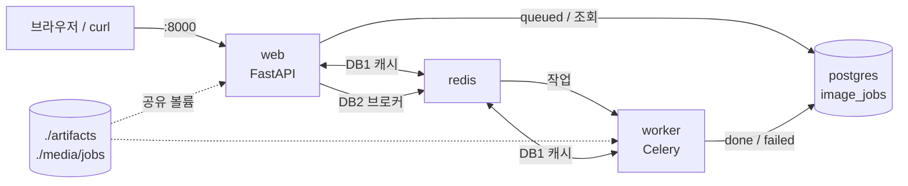

# 산출물 8. 콩잎 질병 분류 Vision AI API 서비스 최종 기술보고서

## 1. 프로젝트 정보

| 항목 | 내용 |
|---|---|
| 프로젝트 | ResNet18 Fine-tuning 기반 콩잎 3클래스 분류 및 동기·비동기 API 서빙 |
| 입력 | 콩잎 이미지 1장 (JPG / PNG / WEBP, 5MB 이하) |
| 출력 | `angular_leaf_spot` (각진잎반점병) / `bean_rust` (콩 녹병) / `healthy` (정상) + 점수 |
| 모델 | `microsoft/resnet-18` → Head-only Fine-tuning → `artifacts/beans_resnet18` |
| 데이터 | Hugging Face `AI-Lab-Makerere/beans` (train 1,034 / val 133 / test 128장) |
| 실행 구조 | **Docker Compose 4개 서비스**: web(FastAPI) · worker(Celery) · redis · postgres |
| 저장소 | https://github.com/howolcat/assessment_deliverables |

---

## 2. 모델 학습 결과

| 실험 | 학습 대상 | epochs / lr | Best Val Acc | Test Acc | 질병 → healthy 오판 (Test) | 역할 |
|---|---|---|---:|---:|---:|---|
| **A. Head-only** | 분류층만 | 3 / 2e-4 | 0.7669 | **0.7188** | 13 / 86장 | **서비스 모델** (필수) |
| B. Full Fine-tuning | 전체 | 3 / 2e-4 | **0.9699** | **0.9297** | 0 | 선택 비교 |
| C. Full + 낮은 lr | 전체 | 3 / 5e-5 | **0.9699** | 0.9531 * | 0 | 추가 실험 |
| D. Head-only 10 epoch | 분류층만 | 10 / 2e-4 | 0.8947 | 0.8828 * | 1 | 추가 실험 |

\* C·D의 Test는 A·B Test를 확인한 뒤 측정한 **참고 지표**이며, 모델 선택에 사용하지 않았다.

- 학습: 로컬 WSL2, **RTX 3060 GPU** (Python 3.14.4, torch 2.15.0+cu132), 모든 실험 seed 42 (A와 D의 1~3 epoch 결과가 동일해 재현성 확인)
- 비교·판단은 **Validation 기준**, A·B의 Test는 선택이 끝난 뒤 별도 도구(`reports/evaluate_test.py`)로 **1회** 측정
- **Validation으로 본 결론**: ① Full(B·C)이 가장 높고 둘은 동률(129/133)이라 구분할 수 없다. ② Head-only는 epoch를 늘리면 +12.8%p 오르지만 Full보다 7.5%p 낮다.
- 평가 기준(필수 = Head-only, 서비스 경로 = `artifacts/beans_resnet18`)에 맞춰 **서비스에는 A(Head-only)를 연결**했다.

근거: [산출물 1](01_FineTuning_결과보고서.md) · `data/training_report*.json` · `data/test_eval.json` · `data/test_eval_CD.json`

---

## 3. 아키텍처와 데이터 흐름



- **동기**: 브라우저 → FastAPI → Redis 캐시 → (MISS면) ResNet18 → 200 응답
- **비동기**: 브라우저 → FastAPI → 파일 저장·DB `queued` → Redis 브로커 → Worker → 캐시·ResNet18 → DB `done` → 브라우저가 상태 조회
- 모델은 web·worker **각 프로세스에 따로 로드**되며, 추론은 **CPU**(컨테이너 torch 2.5.1+cpu)로 실행된다.
- 평가가이드 샘플(FastAPI·Celery를 WSL에서 실행)과 달리, 02 제공 문서의 `compose.yaml`대로 **4개 서비스를 모두 Docker로** 실행했다.

근거: [산출물 2](02_시스템_아키텍처.md)

---

## 4. API와 DB

| API | 성공 | 주요 오류 (실환경 확인) |
|---|---:|---|
| `GET /health` | 200 | 서버 정지 시 연결 실패 |
| `POST /api/sync/classify/` | 200 | 400, 413 |
| `POST /api/async/classify/` | **202** (접수) | 400, 413, 503 |
| `GET /api/async/jobs/{job_id}/` | 200 (`done` = 완료) | 404 |

- DB: PostgreSQL `image_jobs` 1개 테이블. **비동기 작업만** 기록하며, 이미지 원본은 `media/jobs/<uuid>.bin`에 따로 저장
- 상태: `queued` → `running` → `done` / `failed` — `queued`(job 5), `done`, `failed`(job 16)를 실제로 관찰

근거: [산출물 3](03_API_명세서.md) · [산출물 4](04_DB_구조_작업이력.md)

---

## 5. 버튼 처리 검증

| 구분 | 동기 | 비동기 |
|---|---|---|
| 응답 | 200 + 결과 | 202 + `job_id` → 폴링으로 결과 |
| 추론 위치 | web | worker |
| 실제 예 | healthy_test.39: MISS → HIT | job 1: 202 → `received` → `succeeded in 2.22s` → done |
| 웹 화면 | `HTTP 200 / 응답까지 OOms` | `접수 19ms / 전체 1039ms / 상태 done` (job 4) |

근거: [산출물 5](05_AI버튼_처리흐름.md)

---

## 6. 성능 비교 (Docker CPU, 조건별 5회 중앙값)

| 경로 | 캐시 | HTTP 응답 | 최종 결과 확인 | 모델 추론 |
|---|---|---:|---:|---:|
| 동기 | MISS | 41.2ms | 41.2ms | 28.94ms |
| 동기 | HIT | **4.3ms** | 4.3ms | NULL (생략) |
| 비동기 | MISS | **13.4ms** (접수) | 71.6ms | 24.24ms |
| 비동기 | HIT | 9.6ms (접수) | 66.3ms | NULL (생략) |

- **캐시 HIT**: 동기 응답 **89.6% 감소**
- **비동기 접수**: 동기보다 HTTP 응답 **67.5% 빠름** — 추론이 빨라진 것이 아니라 접수와 처리를 분리한 효과
- **결과 확인**: 클라이언트 기준 비동기가 **30.4ms 더 느림** — 대부분 폴링 대기. DB 기준 실제 서버 처리는 **MISS 39ms / HIT 9ms**로, 비동기 구조 자체의 비용은 약 9ms
- **개선 제안**: 짧은 작업은 폴링 간격 조정이나 WebSocket·SSE 알림으로 결과 전달 시간을 줄일 수 있음 (미구현)
- 모델 첫 로딩(2~3.7초)은 비교에서 제외하고 따로 기록

근거: [산출물 6](06_성능비교_보고서.md) · `data/timings.csv`

---

## 7. 기능 테스트와 오류 조치

- **실환경 20건 모두 PASS**: 정상 동작, 400·404·413·503, 캐시 HIT/MISS, worker 정지·재시작, Redis 정지·복구
- **모의 테스트**: `tests/test_api.py` **4 passed** (실환경 결과와 구분해 기록)
- **주요 오류**: 문서 명령 `pytest` 실행 시 `ModuleNotFoundError` → 코드 수정 없이 `python -m pytest`로 해결 (E-02)
- **장애 대응 확인**: Redis 정지 시 동기는 캐시 폴백으로 계속 동작, 비동기는 503 + `failed` 기록, Redis 복구 후 worker 자동 재연결

근거: [산출물 7](07_기능테스트_오류분석.md)

---

## 8. 성능 개선 제안

> 아래 표의 **"근거"** 열은 실제 측정에서 나온 사실이고, **"상태"** 열은 구현 여부다. 미구현 제안은 개선 효과를 주장하지 않는다.

| # | 제안 | 근거 (실측) | 상태 |
|---|---|---|---|
| 1 | **서비스 모델을 Full Fine-tuning으로 교체** | Val 0.7669 → 0.9699, Test 0.7188 → 0.9297, 질병 → healthy 오판 13건 → 0건 | 비교 실험 **완료** / 서비스 교체 **미적용** (평가 기준상 Head-only 유지) |
| 2 | Full 학습 시 학습률 낮추기 | B는 epoch 1 이후 Val 하락 (0.9699 → 0.9398). **실험 C(lr 5e-5)에서 epoch 3 Val 0.9624로 하락이 줄었으나 최고점은 0.9699로 같음** | **실측 완료** — 과적합 완화 효과 있음, 최고 성능 향상은 없음 |
| 3 | Head-only 학습 epoch 늘리기 | A는 3 epoch까지 Loss가 계속 감소. **실험 D(10 epoch)에서 Val 0.7669 → 0.8947 (+12.8%p, epoch 8 최고)** | **실측 완료** — 효과 큼, 단 Full보다는 낮음 |
| 4 | 학습 데이터 증강 (회전·좌우 반전·밝기) | 조명·배경이 다양한 야외 사진 | **미구현** (제공 코드 수정 필요) |
| 5 | **저신뢰 결과를 `확인 필요`로 분리** (top1·top2 점수 차가 작을 때) | job 1: bean_rust 0.4388 vs healthy 0.4356 (차이 0.003) | **미구현**, 임계값 미검증 |
| 6 | OpenCV HSV 병반 후보 면적비를 보조 특징으로 사용 | Head-only는 10 epoch(D)에서도 녹병 → 각진잎반점병 혼동이 9건 남음 | **미구현**, 효과 미검증 |
| 7 | Grad-CAM으로 오분류 원인 확인 | 질병 → healthy 오판 13장의 판단 근거 확인 필요 | **미구현** (설명 도구, 정확도를 직접 높이지 않음) |

### 제안 5·6 설계 (미구현)

```text
입력 이미지
  ├─ ResNet18 → top1, top2 점수
  └─ OpenCV: RGB → HSV → 잎 마스크 → 황색·갈색 병반 후보 마스크 → Opening/Closing → 면적비
판단 규칙 (임계값은 Train으로 정하고 Validation으로 비교, Test는 확정 후 1회)
  ├─ top1 − top2 점수 차가 작음                  → review_required = true
  ├─ top1 = healthy 인데 병반 후보 면적비가 높음   → review_required = true
  └─ 그 외                                       → AI 결과 유지
※ 3클래스 예측은 바꾸지 않고 review_required 플래그만 추가 (기본 API에 없는 확장 필드)
※ HSV 마스크는 병명을 확정하는 진단 근거가 아니며, 흙·햇빛·그림자에 따라 오검출 가능
```

**권장 순서**: ① 서비스 모델을 Full Fine-tuning(B 또는 C)으로 교체 검토 — 둘은 Validation으로 구분되지 않으므로, 교체 전에 Validation을 늘리거나 교차검증으로 다시 비교 → ② 데이터 증강으로 일반화 개선 → ③ Grad-CAM으로 남은 질병 간 혼동 원인 분석 → ④ 규칙 기반 `확인 필요` 분기

---

## 9. 최종 판정과 한계

| 평가 항목 | 판정 |
|---|---|
| 데이터 준비 (3클래스, train/val/test, 중복 점검) | ✅ 완료 |
| Head-only Fine-tuning·모델 저장 | ✅ 완료 (Val 0.7669) |
| 동기 분류 API | ✅ 완료 |
| 비동기 접수·상태 조회 (Celery) | ✅ 완료 |
| PostgreSQL 작업 기록·Redis 캐시 | ✅ 완료 |
| 동기·비동기·캐시 성능 비교 | ✅ 완료 |
| 산출물 8종 + README | ✅ 제출 |
| 선택: Full Fine-tuning 비교 | ✅ 완료 |
| 추가: 학습 옵션 실험 (lr, epoch) | ✅ 완료 (Validation 비교) |
| 선택: OpenCV·규칙·ML 융합 | 설계 제안만 (미구현) |

**모델 분류 품질**: 서비스 모델(Head-only 3 epoch)은 Test 0.7188로, 특히 병든 잎의 15.1%를 정상으로 판정하는 한계가 있다. 추가 실험에서 이 한계의 상당 부분은 **학습 부족**(10 epoch로 Val +12.8%p)이었고, 남은 차이는 **Backbone을 고정한 방식 자체**(Full 대비 −7.5%p)에서 온다는 것을 확인했다. 같은 코드로 학습한 Full Fine-tuning은 Val 0.9699로 가장 높아, 서비스 교체가 가장 효과가 큰 다음 단계다.

**한계**

- 서비스 모델(Head-only 3 epoch)은 덜 학습된 상태이며, Full은 과적합 경향이 있다 (낮은 학습률로 완화 가능).
- Validation으로 Best epoch를 골라 Validation 수치가 Test보다 1~5%p 높다.
- Validation 133장은 1장이 약 0.75%p라 B·C 같은 작은 차이를 구분하지 못한다.
- C·D의 Test는 A·B Test 확인 뒤의 참고 지표로, 독립적인 최종 평가가 아니다.
- md5로는 같은 잎의 유사 사진 중복까지 확인하지 못했다.
- 성능 측정은 5회·단일 요청 기준이며, 동시 요청 처리량은 측정하지 않았다.
- 학습(로컬 GPU, torch 2.15)과 서비스(Docker CPU, torch 2.5.1)의 실행환경이 다르다.
- 503으로 실패한 작업의 업로드 파일이 `media/jobs/`에 남는다 (정리 기능 없음).

---

## 10. 산출물 목록

| # | 문서 | 내용 |
|---|---|---|
| 1 | [01_FineTuning_결과보고서.md](01_FineTuning_결과보고서.md) | 데이터, 학습 설정·결과, Test 평가, 오류 분석 |
| 2 | [02_시스템_아키텍처.md](02_시스템_아키텍처.md) | 구성도, 컴포넌트 역할, Compose 구성, 실행환경 |
| 3 | [03_API_명세서.md](03_API_명세서.md) | API 6종 요청·응답·오류, 실행 근거 |
| 4 | [04_DB_구조_작업이력.md](04_DB_구조_작업이력.md) | `image_jobs` 정의, 상태 전이, 작업이력 |
| 5 | [05_AI버튼_처리흐름.md](05_AI버튼_처리흐름.md) | 동기·비동기 시퀀스, 코드 대응표 |
| 6 | [06_성능비교_보고서.md](06_성능비교_보고서.md) | 측정 조건·결과·해석 |
| 7 | [07_기능테스트_오류분석.md](07_기능테스트_오류분석.md) | 실환경·모의 테스트, 오류 이력 |
| 8 | 이 문서 + [../README.md](../README.md) | 종합 보고, 실행 안내 |

| 폴더 | 내용 |
|---|---|
| `reports/evidence/` | 실행 캡처, 학습 로그 |
| `reports/data/` | `training_report*.json`, `test_eval.json`, `timings.csv` |
| `reports/figures/` | 성능 그래프, 혼동행렬 |
| `reports/*.py` | 측정 도구 (`measure_timings.py`, `evaluate_test.py`) — 제공 코드 아님 |
